# NBA Feature Dependencies

> Generated by `scripts/build_artifacts.py` from the feature registry (nba_api 1.12.0, discovery 2026-10-29). Do not edit by hand - edit `scripts/registry/` and rebuild.

## How to read this

* **Temporal status** (node colour) is the key leakage control. Every node is one of:
  * `label` - Outcome of the target game. Never a feature for that game.
  * `lagged_observed` - Observed in games completed BEFORE the target game; usable only with a strict as-of cutoff.
  * `pregame_known` - Known before tip-off without modelling (schedule, venue, rest).
  * `projected` - Model output computed pregame from lagged/pregame inputs; a forecast, not an observation.
  * `external_pregame` - Obtained pregame from a non-nba_api source.
  * `unverified` - Pregame timing or availability not established.
* Arrows run from an input to the feature built from it. Solid = required, dashed = optional upgrade.
* Node shape: `[ ]` RAW, `( )` CALCULATED, `([ ])` ENGINEERED, `{{ }}` EXTERNAL, `[/ /]` UNVERIFIED. Cylinders are nba_api endpoints.
* Past-game outcomes (`LBL_*`) appear only as inputs to *lagged* rolling features. The target game's own outcome is never an input to a pregame node (enforced by `registry/checks.py`).
* "Projected" nodes are model outputs (forecasts), not observations. A deterministic calculation and a statistical forecast are never labelled the same.

## Pipelines by prop market

### PTS  (target: `LBL_PTS`)

**MVP fallback:** FRM_SHRUNK_RATE (points per minute) x MIN_EXP, with a pace multiplier

**Causal order (before tip-off -> distribution):**

* **1. Minutes** - Projected minutes distribution (incl. DNP mass).  
  `MIN_ROLL` (CALC, P0), `MIN_EWMA` (CALC, P0), `MIN_START_RATE` (CALC, P0), `USGR_MINUTES_VACANCY` (ENGI, P0), `BLO_PROB_BLOWOUT` (ENGI, P0), `CTX_DAYS_REST` (CALC, P0), `MIN_EXP` (ENGI, P0)
* **2. Possessions** - Expected on-court possessions = k x pace x minutes / 48.  
  `ENV_EXP_GAME_POSS` (ENGI, P0), `POS_MATCHUP_PACE_EXP` (ENGI, P0), `POS_ONCOURT_FACTOR` (CALC, P0), `EXP_ONCOURT_POSS` (ENGI, P0)
* **3. Shot attempts** - Attempts per possession x possessions, adjusted for opponent and teammates.  
  `USG_FGA_PER_100POSS` (CALC, P0), `ADJ_OPP_ALLOWED_RATE` (CALC, P0), `AVL_TEAMMATE_OUT_USAGE` (EXTE, P0), `EXP_FGA` (ENGI, P0), `EXP_FTA` (ENGI, P0)
* **4. Shot-type split** - FGA split into 3PA and 2PA.  
  `TPT_3PA_RATE` (CALC, P0), `TPT_OPP_3PA_ALLOWED` (CALC, P0), `EXP_3PA` (ENGI, P0)
* **5. Efficiency** - Make probabilities by shot type (shrunk talent).  
  `SHT_FG_PCT_SHRUNK` (ENGI, P0), `TPT_3P_PCT_SHRUNK` (ENGI, P0), `EXP_3P_PCT` (ENGI, P0), `SHT_FT_PCT_SHRUNK` (ENGI, P0)
* **6. Distribution** - Simulate attempts and makes -> points distribution -> P(over/under).  
  `VAR_DISP_FGA` (ENGI, P0), `EXP_PTS_DIST` (ENGI, P0)

**Known before tip-off** (nodes feeding the root): `MIN_ROLL`, `MIN_EWMA`, `MIN_START_FLAG_HIST`, `MIN_START_RATE`, `CTX_DAYS_REST`, `POS_TEAM_OFF_RTG_ROLL`, `POS_TEAM_DEF_RTG_ROLL`, `POS_TEAM_PACE_ROLL`, `CTX_HOME`, `POS_MATCHUP_PACE_EXP`, `ENV_EXP_GAME_POSS`, `BLO_RATING_SPREAD_PROXY`, `BLO_SPREAD_LIVE`, `BLO_SPREAD_HISTORICAL`, `BLO_PROB_BLOWOUT`, `EXT_INJURY_REPORT`, `AVL_PLAYED_FLAG_HIST`, `BOX_USG_PCT`, `USG_ROLL`, `AVL_TEAMMATE_OUT_USAGE`, `ARC_POSITION`, `USGR_MINUTES_VACANCY`, `EXT_CONFIRMED_STARTERS`, `MIN_START_PROB_TODAY`, `MIN_FOUL_TROUBLE_RATE`, `CTX_B2B`, `MIN_BACK_TO_BACK_DELTA`, `MIN_EXP`, `BOX_POSS`, `POS_ONCOURT_FACTOR`, `EXP_ONCOURT_POSS`, `USG_FGA_PER_100POSS`, `ADJ_OPP_ALLOWED_RATE`, `USG_FGA_PER_MIN`, `USGR_POOLED_ELASTICITY`, `USGR_WITH_WITHOUT`, `EXP_FGA`, `USG_FTA_RATE`, `EXP_FTA`, `TPT_3PA_RATE`, `TPT_OPP_3PA_ALLOWED`, `EXP_3PA`, `TPT_3P_PCT_SHRUNK`, `TPT_CS_3PA_SHARE`, `TPT_OPP_3P_PCT_ALLOWED`, `EXP_3P_PCT`, `SHT_FG_PCT_SHRUNK`, `SHT_FT_PCT_SHRUNK`, `FRM_ROLL_RATE`, `FRM_PRIOR_SEASON_RATE`, `BOX_AST_PCT`, `AST_PCT_ROLL`, `BOX_REB_PCT`, `BOX_OREB_PCT`, `BOX_DREB_PCT`, `REB_PCT_ROLL`, `SHT_ZONE_FREQ`, `ARC_CLUSTER_ID`, `FRM_SHRUNK_RATE`, `VAR_DISP_FGA`, `EXP_PTS_DIST`.

**Outcome (never an input):** `LBL_PTS` in the target game.

```mermaid
flowchart LR
  LBL_MIN["LBL_MIN<br/>Minutes (auxiliary target)"]:::label
  MIN_ROLL("MIN_ROLL<br/>Rolling minutes (mean/median/std)"):::lagged_observed
  MIN_EWMA("MIN_EWMA<br/>Exponentially weighted minutes"):::lagged_observed
  MIN_START_FLAG_HIST("MIN_START_FLAG_HIST<br/>Starter flag in completed games"):::lagged_observed
  MIN_START_RATE("MIN_START_RATE<br/>Starter rate over last N games"):::lagged_observed
  CTX_DAYS_REST("CTX_DAYS_REST<br/>Days of rest"):::pregame_known
  POS_TEAM_OFF_RTG_ROLL("POS_TEAM_OFF_RTG_ROLL<br/>Rolling team offensive rating"):::lagged_observed
  POS_TEAM_DEF_RTG_ROLL("POS_TEAM_DEF_RTG_ROLL<br/>Rolling team defensive rating"):::lagged_observed
  POS_TEAM_PACE_ROLL("POS_TEAM_PACE_ROLL<br/>Rolling team pace"):::lagged_observed
  CTX_HOME("CTX_HOME<br/>Home indicator"):::pregame_known
  POS_MATCHUP_PACE_EXP(["POS_MATCHUP_PACE_EXP<br/>Expected game pace"]):::projected
  ENV_EXP_GAME_POSS(["ENV_EXP_GAME_POSS<br/>Expected possessions in the game"]):::projected
  BLO_RATING_SPREAD_PROXY(["BLO_RATING_SPREAD_PROXY<br/>Spread proxy from team ratings"]):::projected
  BLO_SPREAD_LIVE["BLO_SPREAD_LIVE<br/>Market spread and moneyline (live snapshot)"]:::pregame_known
  BLO_SPREAD_HISTORICAL{{"BLO_SPREAD_HISTORICAL<br/>Historical closing/opening spreads and totals"}}:::external_pregame
  BLO_PROB_BLOWOUT(["BLO_PROB_BLOWOUT<br/>Blowout probability"]):::projected
  EXT_INJURY_REPORT{{"EXT_INJURY_REPORT<br/>Pregame injury report and game-day status"}}:::external_pregame
  AVL_PLAYED_FLAG_HIST("AVL_PLAYED_FLAG_HIST<br/>Who played / did not play, by team-game"):::lagged_observed
  BOX_USG_PCT["BOX_USG_PCT<br/>Usage rate (game)"]:::lagged_observed
  USG_ROLL("USG_ROLL<br/>Rolling usage"):::lagged_observed
  AVL_TEAMMATE_OUT_USAGE{{"AVL_TEAMMATE_OUT_USAGE<br/>Absent teammates' usage/minutes mass"}}:::external_pregame
  ARC_POSITION["ARC_POSITION<br/>Listed position"]:::pregame_known
  USGR_MINUTES_VACANCY(["USGR_MINUTES_VACANCY<br/>Minutes vacancy and who absorbs it"]):::projected
  EXT_CONFIRMED_STARTERS{{"EXT_CONFIRMED_STARTERS<br/>Confirmed or expected starting lineups"}}:::external_pregame
  MIN_START_PROB_TODAY(["MIN_START_PROB_TODAY<br/>Probability of starting today"]):::projected
  MIN_FOUL_TROUBLE_RATE("MIN_FOUL_TROUBLE_RATE<br/>Foul-trouble minutes risk"):::lagged_observed
  CTX_B2B("CTX_B2B<br/>Back-to-back / dense-schedule flags"):::pregame_known
  MIN_BACK_TO_BACK_DELTA("MIN_BACK_TO_BACK_DELTA<br/>Minutes change on back-to-backs"):::lagged_observed
  MIN_EXP(["MIN_EXP<br/>Projected minutes (distribution)"]):::projected
  BOX_POSS["BOX_POSS<br/>On-court possessions (game)"]:::lagged_observed
  POS_ONCOURT_FACTOR("POS_ONCOURT_FACTOR<br/>Player on-court pace factor"):::lagged_observed
  EXP_ONCOURT_POSS(["EXP_ONCOURT_POSS<br/>Expected on-court possessions"]):::projected
  USG_FGA_PER_100POSS("USG_FGA_PER_100POSS<br/>FGA per 100 on-court possessions"):::lagged_observed
  ADJ_OPP_ALLOWED_RATE("ADJ_OPP_ALLOWED_RATE<br/>Opponent rate allowed (shrunk, pace-normalised)"):::lagged_observed
  LBL_FGA["LBL_FGA<br/>FGA (auxiliary target)"]:::label
  USG_FGA_PER_MIN("USG_FGA_PER_MIN<br/>FGA per minute"):::lagged_observed
  USGR_POOLED_ELASTICITY(["USGR_POOLED_ELASTICITY<br/>Pooled redistribution model"]):::projected
  USGR_WITH_WITHOUT("USGR_WITH_WITHOUT<br/>With/without teammate effect (empirical)"):::lagged_observed
  EXP_FGA(["EXP_FGA<br/>Expected shot attempts"]):::projected
  USG_FTA_RATE("USG_FTA_RATE<br/>Free-throw attempt rate"):::lagged_observed
  EXP_FTA(["EXP_FTA<br/>Expected free-throw attempts"]):::projected
  LBL_FG3A["LBL_FG3A<br/>FG3A (auxiliary target)"]:::label
  TPT_3PA_RATE("TPT_3PA_RATE<br/>Three-point attempt rate"):::lagged_observed
  TPT_OPP_3PA_ALLOWED("TPT_OPP_3PA_ALLOWED<br/>Opponent 3PA allowed per 100 possessions"):::lagged_observed
  EXP_3PA(["EXP_3PA<br/>Expected three-point attempts"]):::projected
  TPT_3P_PCT_SHRUNK(["TPT_3P_PCT_SHRUNK<br/>Shrunk 3P%"]):::lagged_observed
  TPT_CS_3PA_SHARE("TPT_CS_3PA_SHARE<br/>Catch-and-shoot share of threes"):::lagged_observed
  TPT_OPP_3P_PCT_ALLOWED(["TPT_OPP_3P_PCT_ALLOWED<br/>Opponent 3P% allowed (shrunk)"]):::lagged_observed
  EXP_3P_PCT(["EXP_3P_PCT<br/>Expected three-point make probability"]):::projected
  SHT_FG_PCT_SHRUNK(["SHT_FG_PCT_SHRUNK<br/>Shrunk FG% (2-point and overall)"]):::lagged_observed
  SHT_FT_PCT_SHRUNK(["SHT_FT_PCT_SHRUNK<br/>Shrunk FT%"]):::lagged_observed
  FRM_ROLL_RATE("FRM_ROLL_RATE<br/>Rolling per-minute and per-possession rates"):::lagged_observed
  FRM_PRIOR_SEASON_RATE("FRM_PRIOR_SEASON_RATE<br/>Prior-season rates (prior)"):::lagged_observed
  BOX_AST_PCT["BOX_AST_PCT<br/>Assist % (game)"]:::lagged_observed
  AST_PCT_ROLL("AST_PCT_ROLL<br/>Rolling assist percentage"):::lagged_observed
  BOX_REB_PCT["BOX_REB_PCT<br/>Rebound % (game)"]:::lagged_observed
  BOX_OREB_PCT["BOX_OREB_PCT<br/>Offensive rebound % (game)"]:::lagged_observed
  BOX_DREB_PCT["BOX_DREB_PCT<br/>Defensive rebound % (game)"]:::lagged_observed
  REB_PCT_ROLL("REB_PCT_ROLL<br/>Rolling rebound percentage"):::lagged_observed
  SHT_ZONE_FREQ("SHT_ZONE_FREQ<br/>Shot-zone frequency profile"):::lagged_observed
  ARC_CLUSTER_ID(["ARC_CLUSTER_ID<br/>Role archetype cluster"]):::lagged_observed
  FRM_SHRUNK_RATE(["FRM_SHRUNK_RATE<br/>Shrunk stat rates"]):::lagged_observed
  VAR_DISP_FGA(["VAR_DISP_FGA<br/>Negative-binomial dispersion: field-goal attempts (compound scoring pipeline)"]):::lagged_observed
  EXP_PTS_DIST(["EXP_PTS_DIST<br/>Expected points (distribution)"]):::projected
  EP_LeagueGameLog --> LBL_MIN
  EP_PlayerGameLogs --> LBL_MIN
  LBL_MIN --> MIN_ROLL
  LBL_MIN --> MIN_EWMA
  EP_BoxScoreTraditionalV3 --> MIN_START_FLAG_HIST
  MIN_START_FLAG_HIST --> MIN_START_RATE
  EP_ScheduleLeagueV2 --> CTX_DAYS_REST
  EP_LeagueGameLog --> CTX_DAYS_REST
  EP_TeamGameLogs --> POS_TEAM_OFF_RTG_ROLL
  EP_TeamGameLogs --> POS_TEAM_DEF_RTG_ROLL
  EP_TeamGameLogs --> POS_TEAM_PACE_ROLL
  EP_LeagueDashTeamStats --> POS_TEAM_PACE_ROLL
  EP_PlayerGameLogs --> CTX_HOME
  EP_ScheduleLeagueV2 --> CTX_HOME
  POS_TEAM_PACE_ROLL --> POS_MATCHUP_PACE_EXP
  CTX_HOME --> POS_MATCHUP_PACE_EXP
  CTX_DAYS_REST --> POS_MATCHUP_PACE_EXP
  POS_MATCHUP_PACE_EXP --> ENV_EXP_GAME_POSS
  POS_TEAM_OFF_RTG_ROLL --> BLO_RATING_SPREAD_PROXY
  POS_TEAM_DEF_RTG_ROLL --> BLO_RATING_SPREAD_PROXY
  ENV_EXP_GAME_POSS --> BLO_RATING_SPREAD_PROXY
  CTX_HOME --> BLO_RATING_SPREAD_PROXY
  EP_Odds__nba_api_live_ --> BLO_SPREAD_LIVE
  BLO_RATING_SPREAD_PROXY --> BLO_PROB_BLOWOUT
  BLO_SPREAD_LIVE -.-> BLO_PROB_BLOWOUT
  BLO_SPREAD_HISTORICAL -.-> BLO_PROB_BLOWOUT
  EP_LeagueGameLog --> AVL_PLAYED_FLAG_HIST
  EP_ScheduleLeagueV2 --> AVL_PLAYED_FLAG_HIST
  EP_PlayerGameLogs --> BOX_USG_PCT
  BOX_USG_PCT --> USG_ROLL
  EXT_INJURY_REPORT --> AVL_TEAMMATE_OUT_USAGE
  AVL_PLAYED_FLAG_HIST --> AVL_TEAMMATE_OUT_USAGE
  MIN_ROLL --> AVL_TEAMMATE_OUT_USAGE
  USG_ROLL --> AVL_TEAMMATE_OUT_USAGE
  EP_PlayerIndex --> ARC_POSITION
  EP_CommonPlayerInfo --> ARC_POSITION
  EP_CommonTeamRoster --> ARC_POSITION
  EP_LeagueDashPtDefend --> ARC_POSITION
  MIN_ROLL --> USGR_MINUTES_VACANCY
  AVL_TEAMMATE_OUT_USAGE --> USGR_MINUTES_VACANCY
  ARC_POSITION --> USGR_MINUTES_VACANCY
  MIN_START_RATE --> MIN_START_PROB_TODAY
  AVL_TEAMMATE_OUT_USAGE --> MIN_START_PROB_TODAY
  EXT_CONFIRMED_STARTERS --> MIN_START_PROB_TODAY
  LBL_MIN --> MIN_FOUL_TROUBLE_RATE
  CTX_DAYS_REST --> CTX_B2B
  LBL_MIN --> MIN_BACK_TO_BACK_DELTA
  CTX_B2B --> MIN_BACK_TO_BACK_DELTA
  MIN_ROLL --> MIN_EXP
  MIN_EWMA --> MIN_EXP
  MIN_START_RATE --> MIN_EXP
  CTX_DAYS_REST --> MIN_EXP
  BLO_PROB_BLOWOUT --> MIN_EXP
  USGR_MINUTES_VACANCY --> MIN_EXP
  AVL_TEAMMATE_OUT_USAGE --> MIN_EXP
  MIN_START_PROB_TODAY -.-> MIN_EXP
  MIN_FOUL_TROUBLE_RATE -.-> MIN_EXP
  MIN_BACK_TO_BACK_DELTA -.-> MIN_EXP
  EP_PlayerGameLogs --> BOX_POSS
  BOX_POSS --> POS_ONCOURT_FACTOR
  POS_TEAM_PACE_ROLL --> POS_ONCOURT_FACTOR
  MIN_EXP --> EXP_ONCOURT_POSS
  POS_MATCHUP_PACE_EXP --> EXP_ONCOURT_POSS
  POS_ONCOURT_FACTOR --> EXP_ONCOURT_POSS
  BOX_POSS --> USG_FGA_PER_100POSS
  EP_TeamGameLogs --> ADJ_OPP_ALLOWED_RATE
  EP_LeagueGameLog --> LBL_FGA
  LBL_FGA --> USG_FGA_PER_MIN
  LBL_MIN --> USG_FGA_PER_MIN
  AVL_TEAMMATE_OUT_USAGE --> USGR_POOLED_ELASTICITY
  USG_FGA_PER_MIN --> USGR_POOLED_ELASTICITY
  MIN_EXP --> USGR_POOLED_ELASTICITY
  AVL_PLAYED_FLAG_HIST --> USGR_WITH_WITHOUT
  EXP_ONCOURT_POSS --> EXP_FGA
  USG_FGA_PER_100POSS --> EXP_FGA
  ADJ_OPP_ALLOWED_RATE --> EXP_FGA
  AVL_TEAMMATE_OUT_USAGE --> EXP_FGA
  USGR_POOLED_ELASTICITY -.-> EXP_FGA
  USGR_WITH_WITHOUT -.-> EXP_FGA
  LBL_FGA --> USG_FTA_RATE
  EXP_FGA --> EXP_FTA
  USG_FTA_RATE --> EXP_FTA
  EP_LeagueGameLog --> LBL_FG3A
  LBL_FG3A --> TPT_3PA_RATE
  LBL_FGA --> TPT_3PA_RATE
  ADJ_OPP_ALLOWED_RATE --> TPT_OPP_3PA_ALLOWED
  EXP_FGA --> EXP_3PA
  TPT_3PA_RATE --> EXP_3PA
  TPT_OPP_3PA_ALLOWED --> EXP_3PA
  EP_LeagueGameLog --> TPT_3P_PCT_SHRUNK
  EP_LeagueDashPtStats --> TPT_CS_3PA_SHARE
  EP_TeamGameLogs --> TPT_OPP_3P_PCT_ALLOWED
  EP_LeagueDashPtTeamDefend --> TPT_OPP_3P_PCT_ALLOWED
  TPT_3P_PCT_SHRUNK --> EXP_3P_PCT
  TPT_CS_3PA_SHARE -.-> EXP_3P_PCT
  TPT_OPP_3P_PCT_ALLOWED -.-> EXP_3P_PCT
  USG_FGA_PER_MIN --> SHT_FG_PCT_SHRUNK
  EP_LeagueGameLog --> SHT_FT_PCT_SHRUNK
  LBL_MIN --> FRM_ROLL_RATE
  EP_PlayerGameLogs --> FRM_PRIOR_SEASON_RATE
  EP_PlayerGameLogs --> BOX_AST_PCT
  BOX_AST_PCT --> AST_PCT_ROLL
  EP_PlayerGameLogs --> BOX_REB_PCT
  EP_PlayerGameLogs --> BOX_OREB_PCT
  EP_PlayerGameLogs --> BOX_DREB_PCT
  BOX_REB_PCT --> REB_PCT_ROLL
  BOX_OREB_PCT -.-> REB_PCT_ROLL
  BOX_DREB_PCT -.-> REB_PCT_ROLL
  EP_LeagueDashPlayerShotLocations --> SHT_ZONE_FREQ
  USG_ROLL --> ARC_CLUSTER_ID
  AST_PCT_ROLL --> ARC_CLUSTER_ID
  REB_PCT_ROLL --> ARC_CLUSTER_ID
  TPT_3PA_RATE --> ARC_CLUSTER_ID
  SHT_ZONE_FREQ --> ARC_CLUSTER_ID
  FRM_ROLL_RATE --> FRM_SHRUNK_RATE
  FRM_PRIOR_SEASON_RATE --> FRM_SHRUNK_RATE
  ARC_POSITION --> FRM_SHRUNK_RATE
  ARC_CLUSTER_ID -.-> FRM_SHRUNK_RATE
  LBL_FGA --> VAR_DISP_FGA
  MIN_ROLL --> VAR_DISP_FGA
  FRM_SHRUNK_RATE --> VAR_DISP_FGA
  EXP_FGA --> EXP_PTS_DIST
  EXP_FTA --> EXP_PTS_DIST
  EXP_3PA --> EXP_PTS_DIST
  EXP_3P_PCT --> EXP_PTS_DIST
  SHT_FG_PCT_SHRUNK --> EXP_PTS_DIST
  SHT_FT_PCT_SHRUNK --> EXP_PTS_DIST
  VAR_DISP_FGA --> EXP_PTS_DIST
  EP_LeagueGameLog[("LeagueGameLog")]:::endpoint
  EP_PlayerGameLogs[("PlayerGameLogs")]:::endpoint
  EP_BoxScoreTraditionalV3[("BoxScoreTraditionalV3")]:::endpoint
  EP_ScheduleLeagueV2[("ScheduleLeagueV2")]:::endpoint
  EP_TeamGameLogs[("TeamGameLogs")]:::endpoint
  EP_LeagueDashTeamStats[("LeagueDashTeamStats")]:::endpoint
  EP_Odds__nba_api_live_[("Odds (nba_api.live)")]:::endpoint
  EP_PlayerIndex[("PlayerIndex")]:::endpoint
  EP_CommonPlayerInfo[("CommonPlayerInfo")]:::endpoint
  EP_CommonTeamRoster[("CommonTeamRoster")]:::endpoint
  EP_LeagueDashPtDefend[("LeagueDashPtDefend")]:::endpoint
  EP_LeagueDashPtStats[("LeagueDashPtStats")]:::endpoint
  EP_LeagueDashPtTeamDefend[("LeagueDashPtTeamDefend")]:::endpoint
  EP_LeagueDashPlayerShotLocations[("LeagueDashPlayerShotLocations")]:::endpoint
  classDef label fill:#fde2e2,stroke:#a63a3a,color:#400
  classDef lagged_observed fill:#e8eef7,stroke:#1f5fbf,color:#012
  classDef pregame_known fill:#e2f4e8,stroke:#2f7d4f,color:#031
  classDef projected fill:#efe5fb,stroke:#8a4fbf,color:#210
  classDef external_pregame fill:#fdebd7,stroke:#b8631a,color:#310
  classDef unverified fill:#eee,stroke:#888,stroke-dasharray:4 3,color:#222
  classDef endpoint fill:#fff,stroke:#555,color:#111
```

<details><summary>Auto-generated dependency graph</summary>



</details>

### REB  (target: `LBL_REB`)

**MVP fallback:** EXP_REB_BASELINE = REB%_hat x (MIN/48) x total rebounds expected from ENV_EXP_MISSED_SHOTS (no tracking needed)

**Causal order (before tip-off -> distribution):**

* **0. MVP baseline (no tracking)** - Rate-based projection; the opportunity pipeline below must beat it in ablation.  
  `REB_PCT_ROLL` (CALC, P0), `EXP_REB_BASELINE` (ENGI, P0)
* **1. Minutes** - Projected minutes.  
  `MIN_EXP` (ENGI, P0)
* **2. Rebound supply** - Expected missed shots of both teams (supply); history reconciles with total rebounds.  
  `ENV_EXP_GAME_POSS` (ENGI, P0), `REB_AVAILABLE_MISSES_TEAM` (CALC, P0), `ENV_EXP_MISSED_SHOTS` (ENGI, P0), `REB_OPP_OREB_ALLOWED` (CALC, P1)
* **3. Opportunity share** - Share of the available misses the player is positioned to contest, given who else is on the floor.  
  `REB_CHANCES_PER_MIN` (CALC, P1), `REB_OPP_SHARE_PER_MISS` (CALC, P1), `REB_FRONTCOURT_COMPETITION` (ENGI, P2), `AVL_TEAMMATE_OUT_USAGE` (EXTE, P0)
* **4. Rebound chances** - Expected chances = misses during his minutes x share.  
  `EXP_REB_CHANCES` (ENGI, P1)
* **5. Conversion** - Rebounds per chance (shrunk).  
  `REB_CONVERSION` (CALC, P1), `REB_CONVERSION_SHRUNK` (ENGI, P1)
* **6. Distribution** - Binomial thinning of overdispersed chances.  
  `VAR_DISP_REB` (ENGI, P0), `EXP_REB_DIST` (ENGI, P1)

**Known before tip-off** (nodes feeding the root): `POS_TEAM_PACE_ROLL`, `CTX_HOME`, `CTX_DAYS_REST`, `POS_MATCHUP_PACE_EXP`, `ENV_EXP_GAME_POSS`, `REB_AVAILABLE_MISSES_TEAM`, `ENV_EXP_MISSED_SHOTS`, `MIN_ROLL`, `MIN_EWMA`, `MIN_START_FLAG_HIST`, `MIN_START_RATE`, `POS_TEAM_OFF_RTG_ROLL`, `POS_TEAM_DEF_RTG_ROLL`, `BLO_RATING_SPREAD_PROXY`, `BLO_SPREAD_LIVE`, `BLO_SPREAD_HISTORICAL`, `BLO_PROB_BLOWOUT`, `EXT_INJURY_REPORT`, `AVL_PLAYED_FLAG_HIST`, `BOX_USG_PCT`, `USG_ROLL`, `AVL_TEAMMATE_OUT_USAGE`, `ARC_POSITION`, `USGR_MINUTES_VACANCY`, `EXT_CONFIRMED_STARTERS`, `MIN_START_PROB_TODAY`, `MIN_FOUL_TROUBLE_RATE`, `CTX_B2B`, `MIN_BACK_TO_BACK_DELTA`, `MIN_EXP`, `REB_CHANCES_PER_MIN`, `REB_OPP_SHARE_PER_MISS`, `REB_FRONTCOURT_COMPETITION`, `EXP_REB_CHANCES`, `REB_CONVERSION`, `REB_CONVERSION_SHRUNK`, `FRM_ROLL_RATE`, `FRM_PRIOR_SEASON_RATE`, `BOX_AST_PCT`, `AST_PCT_ROLL`, `BOX_REB_PCT`, `BOX_OREB_PCT`, `BOX_DREB_PCT`, `REB_PCT_ROLL`, `TPT_3PA_RATE`, `SHT_ZONE_FREQ`, `ARC_CLUSTER_ID`, `FRM_SHRUNK_RATE`, `VAR_DISP_REB`, `EXP_REB_DIST`.

**Outcome (never an input):** `LBL_REB` in the target game.

```mermaid
flowchart LR
  POS_TEAM_PACE_ROLL("POS_TEAM_PACE_ROLL<br/>Rolling team pace"):::lagged_observed
  CTX_HOME("CTX_HOME<br/>Home indicator"):::pregame_known
  CTX_DAYS_REST("CTX_DAYS_REST<br/>Days of rest"):::pregame_known
  POS_MATCHUP_PACE_EXP(["POS_MATCHUP_PACE_EXP<br/>Expected game pace"]):::projected
  ENV_EXP_GAME_POSS(["ENV_EXP_GAME_POSS<br/>Expected possessions in the game"]):::projected
  REB_AVAILABLE_MISSES_TEAM("REB_AVAILABLE_MISSES_TEAM<br/>Available missed shots in a game (observed)"):::lagged_observed
  ENV_EXP_MISSED_SHOTS(["ENV_EXP_MISSED_SHOTS<br/>Expected missed shots in the game"]):::projected
  LBL_MIN["LBL_MIN<br/>Minutes (auxiliary target)"]:::label
  MIN_ROLL("MIN_ROLL<br/>Rolling minutes (mean/median/std)"):::lagged_observed
  MIN_EWMA("MIN_EWMA<br/>Exponentially weighted minutes"):::lagged_observed
  MIN_START_FLAG_HIST("MIN_START_FLAG_HIST<br/>Starter flag in completed games"):::lagged_observed
  MIN_START_RATE("MIN_START_RATE<br/>Starter rate over last N games"):::lagged_observed
  POS_TEAM_OFF_RTG_ROLL("POS_TEAM_OFF_RTG_ROLL<br/>Rolling team offensive rating"):::lagged_observed
  POS_TEAM_DEF_RTG_ROLL("POS_TEAM_DEF_RTG_ROLL<br/>Rolling team defensive rating"):::lagged_observed
  BLO_RATING_SPREAD_PROXY(["BLO_RATING_SPREAD_PROXY<br/>Spread proxy from team ratings"]):::projected
  BLO_SPREAD_LIVE["BLO_SPREAD_LIVE<br/>Market spread and moneyline (live snapshot)"]:::pregame_known
  BLO_SPREAD_HISTORICAL{{"BLO_SPREAD_HISTORICAL<br/>Historical closing/opening spreads and totals"}}:::external_pregame
  BLO_PROB_BLOWOUT(["BLO_PROB_BLOWOUT<br/>Blowout probability"]):::projected
  EXT_INJURY_REPORT{{"EXT_INJURY_REPORT<br/>Pregame injury report and game-day status"}}:::external_pregame
  AVL_PLAYED_FLAG_HIST("AVL_PLAYED_FLAG_HIST<br/>Who played / did not play, by team-game"):::lagged_observed
  BOX_USG_PCT["BOX_USG_PCT<br/>Usage rate (game)"]:::lagged_observed
  USG_ROLL("USG_ROLL<br/>Rolling usage"):::lagged_observed
  AVL_TEAMMATE_OUT_USAGE{{"AVL_TEAMMATE_OUT_USAGE<br/>Absent teammates' usage/minutes mass"}}:::external_pregame
  ARC_POSITION["ARC_POSITION<br/>Listed position"]:::pregame_known
  USGR_MINUTES_VACANCY(["USGR_MINUTES_VACANCY<br/>Minutes vacancy and who absorbs it"]):::projected
  EXT_CONFIRMED_STARTERS{{"EXT_CONFIRMED_STARTERS<br/>Confirmed or expected starting lineups"}}:::external_pregame
  MIN_START_PROB_TODAY(["MIN_START_PROB_TODAY<br/>Probability of starting today"]):::projected
  MIN_FOUL_TROUBLE_RATE("MIN_FOUL_TROUBLE_RATE<br/>Foul-trouble minutes risk"):::lagged_observed
  CTX_B2B("CTX_B2B<br/>Back-to-back / dense-schedule flags"):::pregame_known
  MIN_BACK_TO_BACK_DELTA("MIN_BACK_TO_BACK_DELTA<br/>Minutes change on back-to-backs"):::lagged_observed
  MIN_EXP(["MIN_EXP<br/>Projected minutes (distribution)"]):::projected
  REB_CHANCES_PER_MIN("REB_CHANCES_PER_MIN<br/>Rebound chances per minute"):::lagged_observed
  REB_OPP_SHARE_PER_MISS("REB_OPP_SHARE_PER_MISS<br/>Rebound opportunity share of available misses"):::lagged_observed
  REB_FRONTCOURT_COMPETITION(["REB_FRONTCOURT_COMPETITION<br/>Frontcourt rebound competition"]):::projected
  EXP_REB_CHANCES(["EXP_REB_CHANCES<br/>Expected rebound chances"]):::projected
  REB_CONVERSION("REB_CONVERSION<br/>Rebound conversion of chances"):::lagged_observed
  REB_CONVERSION_SHRUNK(["REB_CONVERSION_SHRUNK<br/>Shrunk rebound conversion"]):::lagged_observed
  LBL_REB["LBL_REB<br/>REB (target)"]:::label
  FRM_ROLL_RATE("FRM_ROLL_RATE<br/>Rolling per-minute and per-possession rates"):::lagged_observed
  FRM_PRIOR_SEASON_RATE("FRM_PRIOR_SEASON_RATE<br/>Prior-season rates (prior)"):::lagged_observed
  BOX_AST_PCT["BOX_AST_PCT<br/>Assist % (game)"]:::lagged_observed
  AST_PCT_ROLL("AST_PCT_ROLL<br/>Rolling assist percentage"):::lagged_observed
  BOX_REB_PCT["BOX_REB_PCT<br/>Rebound % (game)"]:::lagged_observed
  BOX_OREB_PCT["BOX_OREB_PCT<br/>Offensive rebound % (game)"]:::lagged_observed
  BOX_DREB_PCT["BOX_DREB_PCT<br/>Defensive rebound % (game)"]:::lagged_observed
  REB_PCT_ROLL("REB_PCT_ROLL<br/>Rolling rebound percentage"):::lagged_observed
  LBL_FG3A["LBL_FG3A<br/>FG3A (auxiliary target)"]:::label
  LBL_FGA["LBL_FGA<br/>FGA (auxiliary target)"]:::label
  TPT_3PA_RATE("TPT_3PA_RATE<br/>Three-point attempt rate"):::lagged_observed
  SHT_ZONE_FREQ("SHT_ZONE_FREQ<br/>Shot-zone frequency profile"):::lagged_observed
  ARC_CLUSTER_ID(["ARC_CLUSTER_ID<br/>Role archetype cluster"]):::lagged_observed
  FRM_SHRUNK_RATE(["FRM_SHRUNK_RATE<br/>Shrunk stat rates"]):::lagged_observed
  VAR_DISP_REB(["VAR_DISP_REB<br/>Negative-binomial dispersion: rebounds"]):::lagged_observed
  EXP_REB_DIST(["EXP_REB_DIST<br/>Expected rebounds (distribution)"]):::projected
  EP_TeamGameLogs --> POS_TEAM_PACE_ROLL
  EP_LeagueDashTeamStats --> POS_TEAM_PACE_ROLL
  EP_PlayerGameLogs --> CTX_HOME
  EP_ScheduleLeagueV2 --> CTX_HOME
  EP_ScheduleLeagueV2 --> CTX_DAYS_REST
  EP_LeagueGameLog --> CTX_DAYS_REST
  POS_TEAM_PACE_ROLL --> POS_MATCHUP_PACE_EXP
  CTX_HOME --> POS_MATCHUP_PACE_EXP
  CTX_DAYS_REST --> POS_MATCHUP_PACE_EXP
  POS_MATCHUP_PACE_EXP --> ENV_EXP_GAME_POSS
  EP_TeamGameLogs --> REB_AVAILABLE_MISSES_TEAM
  ENV_EXP_GAME_POSS --> ENV_EXP_MISSED_SHOTS
  REB_AVAILABLE_MISSES_TEAM --> ENV_EXP_MISSED_SHOTS
  EP_LeagueGameLog --> LBL_MIN
  EP_PlayerGameLogs --> LBL_MIN
  LBL_MIN --> MIN_ROLL
  LBL_MIN --> MIN_EWMA
  EP_BoxScoreTraditionalV3 --> MIN_START_FLAG_HIST
  MIN_START_FLAG_HIST --> MIN_START_RATE
  EP_TeamGameLogs --> POS_TEAM_OFF_RTG_ROLL
  EP_TeamGameLogs --> POS_TEAM_DEF_RTG_ROLL
  POS_TEAM_OFF_RTG_ROLL --> BLO_RATING_SPREAD_PROXY
  POS_TEAM_DEF_RTG_ROLL --> BLO_RATING_SPREAD_PROXY
  ENV_EXP_GAME_POSS --> BLO_RATING_SPREAD_PROXY
  CTX_HOME --> BLO_RATING_SPREAD_PROXY
  EP_Odds__nba_api_live_ --> BLO_SPREAD_LIVE
  BLO_RATING_SPREAD_PROXY --> BLO_PROB_BLOWOUT
  BLO_SPREAD_LIVE -.-> BLO_PROB_BLOWOUT
  BLO_SPREAD_HISTORICAL -.-> BLO_PROB_BLOWOUT
  EP_LeagueGameLog --> AVL_PLAYED_FLAG_HIST
  EP_ScheduleLeagueV2 --> AVL_PLAYED_FLAG_HIST
  EP_PlayerGameLogs --> BOX_USG_PCT
  BOX_USG_PCT --> USG_ROLL
  EXT_INJURY_REPORT --> AVL_TEAMMATE_OUT_USAGE
  AVL_PLAYED_FLAG_HIST --> AVL_TEAMMATE_OUT_USAGE
  MIN_ROLL --> AVL_TEAMMATE_OUT_USAGE
  USG_ROLL --> AVL_TEAMMATE_OUT_USAGE
  EP_PlayerIndex --> ARC_POSITION
  EP_CommonPlayerInfo --> ARC_POSITION
  EP_CommonTeamRoster --> ARC_POSITION
  EP_LeagueDashPtDefend --> ARC_POSITION
  MIN_ROLL --> USGR_MINUTES_VACANCY
  AVL_TEAMMATE_OUT_USAGE --> USGR_MINUTES_VACANCY
  ARC_POSITION --> USGR_MINUTES_VACANCY
  MIN_START_RATE --> MIN_START_PROB_TODAY
  AVL_TEAMMATE_OUT_USAGE --> MIN_START_PROB_TODAY
  EXT_CONFIRMED_STARTERS --> MIN_START_PROB_TODAY
  LBL_MIN --> MIN_FOUL_TROUBLE_RATE
  CTX_DAYS_REST --> CTX_B2B
  LBL_MIN --> MIN_BACK_TO_BACK_DELTA
  CTX_B2B --> MIN_BACK_TO_BACK_DELTA
  MIN_ROLL --> MIN_EXP
  MIN_EWMA --> MIN_EXP
  MIN_START_RATE --> MIN_EXP
  CTX_DAYS_REST --> MIN_EXP
  BLO_PROB_BLOWOUT --> MIN_EXP
  USGR_MINUTES_VACANCY --> MIN_EXP
  AVL_TEAMMATE_OUT_USAGE --> MIN_EXP
  MIN_START_PROB_TODAY -.-> MIN_EXP
  MIN_FOUL_TROUBLE_RATE -.-> MIN_EXP
  MIN_BACK_TO_BACK_DELTA -.-> MIN_EXP
  EP_BoxScorePlayerTrackV3 --> REB_CHANCES_PER_MIN
  EP_LeagueDashPtStats --> REB_CHANCES_PER_MIN
  REB_AVAILABLE_MISSES_TEAM --> REB_OPP_SHARE_PER_MISS
  REB_CHANCES_PER_MIN --> REB_OPP_SHARE_PER_MISS
  MIN_EXP --> REB_FRONTCOURT_COMPETITION
  REB_CHANCES_PER_MIN --> REB_FRONTCOURT_COMPETITION
  AVL_TEAMMATE_OUT_USAGE --> REB_FRONTCOURT_COMPETITION
  ENV_EXP_MISSED_SHOTS --> EXP_REB_CHANCES
  MIN_EXP --> EXP_REB_CHANCES
  REB_OPP_SHARE_PER_MISS --> EXP_REB_CHANCES
  REB_FRONTCOURT_COMPETITION --> EXP_REB_CHANCES
  REB_CHANCES_PER_MIN --> REB_CONVERSION
  REB_CONVERSION --> REB_CONVERSION_SHRUNK
  EP_LeagueGameLog --> LBL_REB
  EP_PlayerGameLogs --> LBL_REB
  LBL_MIN --> FRM_ROLL_RATE
  EP_PlayerGameLogs --> FRM_PRIOR_SEASON_RATE
  EP_PlayerGameLogs --> BOX_AST_PCT
  BOX_AST_PCT --> AST_PCT_ROLL
  EP_PlayerGameLogs --> BOX_REB_PCT
  EP_PlayerGameLogs --> BOX_OREB_PCT
  EP_PlayerGameLogs --> BOX_DREB_PCT
  BOX_REB_PCT --> REB_PCT_ROLL
  BOX_OREB_PCT -.-> REB_PCT_ROLL
  BOX_DREB_PCT -.-> REB_PCT_ROLL
  EP_LeagueGameLog --> LBL_FG3A
  EP_LeagueGameLog --> LBL_FGA
  LBL_FG3A --> TPT_3PA_RATE
  LBL_FGA --> TPT_3PA_RATE
  EP_LeagueDashPlayerShotLocations --> SHT_ZONE_FREQ
  USG_ROLL --> ARC_CLUSTER_ID
  AST_PCT_ROLL --> ARC_CLUSTER_ID
  REB_PCT_ROLL --> ARC_CLUSTER_ID
  TPT_3PA_RATE --> ARC_CLUSTER_ID
  SHT_ZONE_FREQ --> ARC_CLUSTER_ID
  FRM_ROLL_RATE --> FRM_SHRUNK_RATE
  FRM_PRIOR_SEASON_RATE --> FRM_SHRUNK_RATE
  ARC_POSITION --> FRM_SHRUNK_RATE
  ARC_CLUSTER_ID -.-> FRM_SHRUNK_RATE
  LBL_REB --> VAR_DISP_REB
  MIN_ROLL --> VAR_DISP_REB
  FRM_SHRUNK_RATE --> VAR_DISP_REB
  EXP_REB_CHANCES --> EXP_REB_DIST
  REB_CONVERSION_SHRUNK --> EXP_REB_DIST
  VAR_DISP_REB --> EXP_REB_DIST
  EP_TeamGameLogs[("TeamGameLogs")]:::endpoint
  EP_LeagueDashTeamStats[("LeagueDashTeamStats")]:::endpoint
  EP_PlayerGameLogs[("PlayerGameLogs")]:::endpoint
  EP_ScheduleLeagueV2[("ScheduleLeagueV2")]:::endpoint
  EP_LeagueGameLog[("LeagueGameLog")]:::endpoint
  EP_BoxScoreTraditionalV3[("BoxScoreTraditionalV3")]:::endpoint
  EP_Odds__nba_api_live_[("Odds (nba_api.live)")]:::endpoint
  EP_PlayerIndex[("PlayerIndex")]:::endpoint
  EP_CommonPlayerInfo[("CommonPlayerInfo")]:::endpoint
  EP_CommonTeamRoster[("CommonTeamRoster")]:::endpoint
  EP_LeagueDashPtDefend[("LeagueDashPtDefend")]:::endpoint
  EP_BoxScorePlayerTrackV3[("BoxScorePlayerTrackV3")]:::endpoint
  EP_LeagueDashPtStats[("LeagueDashPtStats")]:::endpoint
  EP_LeagueDashPlayerShotLocations[("LeagueDashPlayerShotLocations")]:::endpoint
  classDef label fill:#fde2e2,stroke:#a63a3a,color:#400
  classDef lagged_observed fill:#e8eef7,stroke:#1f5fbf,color:#012
  classDef pregame_known fill:#e2f4e8,stroke:#2f7d4f,color:#031
  classDef projected fill:#efe5fb,stroke:#8a4fbf,color:#210
  classDef external_pregame fill:#fdebd7,stroke:#b8631a,color:#310
  classDef unverified fill:#eee,stroke:#888,stroke-dasharray:4 3,color:#222
  classDef endpoint fill:#fff,stroke:#555,color:#111
```

<details><summary>Auto-generated dependency graph</summary>



</details>

### AST  (target: `LBL_AST`)

**MVP fallback:** EXP_AST_BASELINE = AST%_hat x ((MIN/48) x team FGM expected - own FGM expected) (no tracking needed)

**Causal order (before tip-off -> distribution):**

* **0. MVP baseline (no tracking)** - Rate-based projection; the opportunity pipeline below must beat it in ablation.  
  `AST_PCT_ROLL` (CALC, P0), `EXP_AST_BASELINE` (ENGI, P0)
* **1. Minutes** - Projected minutes.  
  `MIN_EXP` (ENGI, P0)
* **2. Possessions** - On-court possessions.  
  `EXP_ONCOURT_POSS` (ENGI, P0)
* **3. Playmaking opportunities** - Potential assists = possessions x potential assists per possession, adjusted for competition and availability.  
  `AST_POT_PER_MIN` (CALC, P1), `AST_POT_PER_100POSS` (CALC, P1), `AST_TEAM_ASSISTED_RATE` (CALC, P1), `AST_BALLHANDLER_COMPETITION` (ENGI, P2), `AST_OPP_ASSISTS_ALLOWED` (CALC, P1), `EXP_POT_AST` (ENGI, P1)
* **4. Teammate conversion** - Probability a creating pass is converted, given the receivers who are available.  
  `AST_CONVERSION` (CALC, P1), `AST_CONVERSION_SHRUNK` (ENGI, P1), `AST_TEAMMATE_CONVERSION_PROB` (ENGI, P2)
* **5. Distribution** - Binomial thinning of overdispersed potential assists.  
  `VAR_DISP_AST` (ENGI, P0), `EXP_AST_DIST` (ENGI, P1)

**Known before tip-off** (nodes feeding the root): `MIN_ROLL`, `MIN_EWMA`, `MIN_START_FLAG_HIST`, `MIN_START_RATE`, `CTX_DAYS_REST`, `POS_TEAM_OFF_RTG_ROLL`, `POS_TEAM_DEF_RTG_ROLL`, `POS_TEAM_PACE_ROLL`, `CTX_HOME`, `POS_MATCHUP_PACE_EXP`, `ENV_EXP_GAME_POSS`, `BLO_RATING_SPREAD_PROXY`, `BLO_SPREAD_LIVE`, `BLO_SPREAD_HISTORICAL`, `BLO_PROB_BLOWOUT`, `EXT_INJURY_REPORT`, `AVL_PLAYED_FLAG_HIST`, `BOX_USG_PCT`, `USG_ROLL`, `AVL_TEAMMATE_OUT_USAGE`, `ARC_POSITION`, `USGR_MINUTES_VACANCY`, `EXT_CONFIRMED_STARTERS`, `MIN_START_PROB_TODAY`, `MIN_FOUL_TROUBLE_RATE`, `CTX_B2B`, `MIN_BACK_TO_BACK_DELTA`, `MIN_EXP`, `BOX_POSS`, `POS_ONCOURT_FACTOR`, `EXP_ONCOURT_POSS`, `AST_POT_PER_MIN`, `AST_POT_PER_100POSS`, `AST_BALLHANDLER_COMPETITION`, `AST_TEAM_ASSISTED_RATE`, `EXP_POT_AST`, `AST_CONVERSION`, `AST_CONVERSION_SHRUNK`, `AST_TEAMMATE_CONVERSION_PROB`, `FRM_ROLL_RATE`, `FRM_PRIOR_SEASON_RATE`, `BOX_AST_PCT`, `AST_PCT_ROLL`, `BOX_REB_PCT`, `BOX_OREB_PCT`, `BOX_DREB_PCT`, `REB_PCT_ROLL`, `TPT_3PA_RATE`, `SHT_ZONE_FREQ`, `ARC_CLUSTER_ID`, `FRM_SHRUNK_RATE`, `VAR_DISP_AST`, `EXP_AST_DIST`.

**Outcome (never an input):** `LBL_AST` in the target game.

```mermaid
flowchart LR
  LBL_MIN["LBL_MIN<br/>Minutes (auxiliary target)"]:::label
  MIN_ROLL("MIN_ROLL<br/>Rolling minutes (mean/median/std)"):::lagged_observed
  MIN_EWMA("MIN_EWMA<br/>Exponentially weighted minutes"):::lagged_observed
  MIN_START_FLAG_HIST("MIN_START_FLAG_HIST<br/>Starter flag in completed games"):::lagged_observed
  MIN_START_RATE("MIN_START_RATE<br/>Starter rate over last N games"):::lagged_observed
  CTX_DAYS_REST("CTX_DAYS_REST<br/>Days of rest"):::pregame_known
  POS_TEAM_OFF_RTG_ROLL("POS_TEAM_OFF_RTG_ROLL<br/>Rolling team offensive rating"):::lagged_observed
  POS_TEAM_DEF_RTG_ROLL("POS_TEAM_DEF_RTG_ROLL<br/>Rolling team defensive rating"):::lagged_observed
  POS_TEAM_PACE_ROLL("POS_TEAM_PACE_ROLL<br/>Rolling team pace"):::lagged_observed
  CTX_HOME("CTX_HOME<br/>Home indicator"):::pregame_known
  POS_MATCHUP_PACE_EXP(["POS_MATCHUP_PACE_EXP<br/>Expected game pace"]):::projected
  ENV_EXP_GAME_POSS(["ENV_EXP_GAME_POSS<br/>Expected possessions in the game"]):::projected
  BLO_RATING_SPREAD_PROXY(["BLO_RATING_SPREAD_PROXY<br/>Spread proxy from team ratings"]):::projected
  BLO_SPREAD_LIVE["BLO_SPREAD_LIVE<br/>Market spread and moneyline (live snapshot)"]:::pregame_known
  BLO_SPREAD_HISTORICAL{{"BLO_SPREAD_HISTORICAL<br/>Historical closing/opening spreads and totals"}}:::external_pregame
  BLO_PROB_BLOWOUT(["BLO_PROB_BLOWOUT<br/>Blowout probability"]):::projected
  EXT_INJURY_REPORT{{"EXT_INJURY_REPORT<br/>Pregame injury report and game-day status"}}:::external_pregame
  AVL_PLAYED_FLAG_HIST("AVL_PLAYED_FLAG_HIST<br/>Who played / did not play, by team-game"):::lagged_observed
  BOX_USG_PCT["BOX_USG_PCT<br/>Usage rate (game)"]:::lagged_observed
  USG_ROLL("USG_ROLL<br/>Rolling usage"):::lagged_observed
  AVL_TEAMMATE_OUT_USAGE{{"AVL_TEAMMATE_OUT_USAGE<br/>Absent teammates' usage/minutes mass"}}:::external_pregame
  ARC_POSITION["ARC_POSITION<br/>Listed position"]:::pregame_known
  USGR_MINUTES_VACANCY(["USGR_MINUTES_VACANCY<br/>Minutes vacancy and who absorbs it"]):::projected
  EXT_CONFIRMED_STARTERS{{"EXT_CONFIRMED_STARTERS<br/>Confirmed or expected starting lineups"}}:::external_pregame
  MIN_START_PROB_TODAY(["MIN_START_PROB_TODAY<br/>Probability of starting today"]):::projected
  MIN_FOUL_TROUBLE_RATE("MIN_FOUL_TROUBLE_RATE<br/>Foul-trouble minutes risk"):::lagged_observed
  CTX_B2B("CTX_B2B<br/>Back-to-back / dense-schedule flags"):::pregame_known
  MIN_BACK_TO_BACK_DELTA("MIN_BACK_TO_BACK_DELTA<br/>Minutes change on back-to-backs"):::lagged_observed
  MIN_EXP(["MIN_EXP<br/>Projected minutes (distribution)"]):::projected
  BOX_POSS["BOX_POSS<br/>On-court possessions (game)"]:::lagged_observed
  POS_ONCOURT_FACTOR("POS_ONCOURT_FACTOR<br/>Player on-court pace factor"):::lagged_observed
  EXP_ONCOURT_POSS(["EXP_ONCOURT_POSS<br/>Expected on-court possessions"]):::projected
  AST_POT_PER_MIN("AST_POT_PER_MIN<br/>Potential assists per minute"):::lagged_observed
  AST_POT_PER_100POSS("AST_POT_PER_100POSS<br/>Potential assists per 100 on-court possessions"):::lagged_observed
  AST_BALLHANDLER_COMPETITION(["AST_BALLHANDLER_COMPETITION<br/>Ball-handler competition"]):::projected
  AST_TEAM_ASSISTED_RATE("AST_TEAM_ASSISTED_RATE<br/>Team assisted-FG rate"):::lagged_observed
  EXP_POT_AST(["EXP_POT_AST<br/>Expected potential assists"]):::projected
  AST_CONVERSION("AST_CONVERSION<br/>Assist conversion of potential assists"):::lagged_observed
  AST_CONVERSION_SHRUNK(["AST_CONVERSION_SHRUNK<br/>Shrunk assist conversion"]):::lagged_observed
  AST_TEAMMATE_CONVERSION_PROB(["AST_TEAMMATE_CONVERSION_PROB<br/>Expected teammate conversion probability"]):::projected
  LBL_AST["LBL_AST<br/>AST (target)"]:::label
  FRM_ROLL_RATE("FRM_ROLL_RATE<br/>Rolling per-minute and per-possession rates"):::lagged_observed
  FRM_PRIOR_SEASON_RATE("FRM_PRIOR_SEASON_RATE<br/>Prior-season rates (prior)"):::lagged_observed
  BOX_AST_PCT["BOX_AST_PCT<br/>Assist % (game)"]:::lagged_observed
  AST_PCT_ROLL("AST_PCT_ROLL<br/>Rolling assist percentage"):::lagged_observed
  BOX_REB_PCT["BOX_REB_PCT<br/>Rebound % (game)"]:::lagged_observed
  BOX_OREB_PCT["BOX_OREB_PCT<br/>Offensive rebound % (game)"]:::lagged_observed
  BOX_DREB_PCT["BOX_DREB_PCT<br/>Defensive rebound % (game)"]:::lagged_observed
  REB_PCT_ROLL("REB_PCT_ROLL<br/>Rolling rebound percentage"):::lagged_observed
  LBL_FG3A["LBL_FG3A<br/>FG3A (auxiliary target)"]:::label
  LBL_FGA["LBL_FGA<br/>FGA (auxiliary target)"]:::label
  TPT_3PA_RATE("TPT_3PA_RATE<br/>Three-point attempt rate"):::lagged_observed
  SHT_ZONE_FREQ("SHT_ZONE_FREQ<br/>Shot-zone frequency profile"):::lagged_observed
  ARC_CLUSTER_ID(["ARC_CLUSTER_ID<br/>Role archetype cluster"]):::lagged_observed
  FRM_SHRUNK_RATE(["FRM_SHRUNK_RATE<br/>Shrunk stat rates"]):::lagged_observed
  VAR_DISP_AST(["VAR_DISP_AST<br/>Negative-binomial dispersion: assists"]):::lagged_observed
  EXP_AST_DIST(["EXP_AST_DIST<br/>Expected assists (distribution)"]):::projected
  EP_LeagueGameLog --> LBL_MIN
  EP_PlayerGameLogs --> LBL_MIN
  LBL_MIN --> MIN_ROLL
  LBL_MIN --> MIN_EWMA
  EP_BoxScoreTraditionalV3 --> MIN_START_FLAG_HIST
  MIN_START_FLAG_HIST --> MIN_START_RATE
  EP_ScheduleLeagueV2 --> CTX_DAYS_REST
  EP_LeagueGameLog --> CTX_DAYS_REST
  EP_TeamGameLogs --> POS_TEAM_OFF_RTG_ROLL
  EP_TeamGameLogs --> POS_TEAM_DEF_RTG_ROLL
  EP_TeamGameLogs --> POS_TEAM_PACE_ROLL
  EP_LeagueDashTeamStats --> POS_TEAM_PACE_ROLL
  EP_PlayerGameLogs --> CTX_HOME
  EP_ScheduleLeagueV2 --> CTX_HOME
  POS_TEAM_PACE_ROLL --> POS_MATCHUP_PACE_EXP
  CTX_HOME --> POS_MATCHUP_PACE_EXP
  CTX_DAYS_REST --> POS_MATCHUP_PACE_EXP
  POS_MATCHUP_PACE_EXP --> ENV_EXP_GAME_POSS
  POS_TEAM_OFF_RTG_ROLL --> BLO_RATING_SPREAD_PROXY
  POS_TEAM_DEF_RTG_ROLL --> BLO_RATING_SPREAD_PROXY
  ENV_EXP_GAME_POSS --> BLO_RATING_SPREAD_PROXY
  CTX_HOME --> BLO_RATING_SPREAD_PROXY
  EP_Odds__nba_api_live_ --> BLO_SPREAD_LIVE
  BLO_RATING_SPREAD_PROXY --> BLO_PROB_BLOWOUT
  BLO_SPREAD_LIVE -.-> BLO_PROB_BLOWOUT
  BLO_SPREAD_HISTORICAL -.-> BLO_PROB_BLOWOUT
  EP_LeagueGameLog --> AVL_PLAYED_FLAG_HIST
  EP_ScheduleLeagueV2 --> AVL_PLAYED_FLAG_HIST
  EP_PlayerGameLogs --> BOX_USG_PCT
  BOX_USG_PCT --> USG_ROLL
  EXT_INJURY_REPORT --> AVL_TEAMMATE_OUT_USAGE
  AVL_PLAYED_FLAG_HIST --> AVL_TEAMMATE_OUT_USAGE
  MIN_ROLL --> AVL_TEAMMATE_OUT_USAGE
  USG_ROLL --> AVL_TEAMMATE_OUT_USAGE
  EP_PlayerIndex --> ARC_POSITION
  EP_CommonPlayerInfo --> ARC_POSITION
  EP_CommonTeamRoster --> ARC_POSITION
  EP_LeagueDashPtDefend --> ARC_POSITION
  MIN_ROLL --> USGR_MINUTES_VACANCY
  AVL_TEAMMATE_OUT_USAGE --> USGR_MINUTES_VACANCY
  ARC_POSITION --> USGR_MINUTES_VACANCY
  MIN_START_RATE --> MIN_START_PROB_TODAY
  AVL_TEAMMATE_OUT_USAGE --> MIN_START_PROB_TODAY
  EXT_CONFIRMED_STARTERS --> MIN_START_PROB_TODAY
  LBL_MIN --> MIN_FOUL_TROUBLE_RATE
  CTX_DAYS_REST --> CTX_B2B
  LBL_MIN --> MIN_BACK_TO_BACK_DELTA
  CTX_B2B --> MIN_BACK_TO_BACK_DELTA
  MIN_ROLL --> MIN_EXP
  MIN_EWMA --> MIN_EXP
  MIN_START_RATE --> MIN_EXP
  CTX_DAYS_REST --> MIN_EXP
  BLO_PROB_BLOWOUT --> MIN_EXP
  USGR_MINUTES_VACANCY --> MIN_EXP
  AVL_TEAMMATE_OUT_USAGE --> MIN_EXP
  MIN_START_PROB_TODAY -.-> MIN_EXP
  MIN_FOUL_TROUBLE_RATE -.-> MIN_EXP
  MIN_BACK_TO_BACK_DELTA -.-> MIN_EXP
  EP_PlayerGameLogs --> BOX_POSS
  BOX_POSS --> POS_ONCOURT_FACTOR
  POS_TEAM_PACE_ROLL --> POS_ONCOURT_FACTOR
  MIN_EXP --> EXP_ONCOURT_POSS
  POS_MATCHUP_PACE_EXP --> EXP_ONCOURT_POSS
  POS_ONCOURT_FACTOR --> EXP_ONCOURT_POSS
  EP_LeagueDashPtStats --> AST_POT_PER_MIN
  AST_POT_PER_MIN --> AST_POT_PER_100POSS
  BOX_POSS --> AST_POT_PER_100POSS
  MIN_EXP --> AST_BALLHANDLER_COMPETITION
  AST_POT_PER_MIN --> AST_BALLHANDLER_COMPETITION
  AVL_TEAMMATE_OUT_USAGE --> AST_BALLHANDLER_COMPETITION
  EP_TeamGameLogs --> AST_TEAM_ASSISTED_RATE
  EXP_ONCOURT_POSS --> EXP_POT_AST
  AST_POT_PER_100POSS --> EXP_POT_AST
  AST_BALLHANDLER_COMPETITION --> EXP_POT_AST
  AST_TEAM_ASSISTED_RATE --> EXP_POT_AST
  AST_POT_PER_MIN --> AST_CONVERSION
  AST_CONVERSION --> AST_CONVERSION_SHRUNK
  AVL_TEAMMATE_OUT_USAGE --> AST_TEAMMATE_CONVERSION_PROB
  AST_CONVERSION_SHRUNK --> AST_TEAMMATE_CONVERSION_PROB
  EP_LeagueGameLog --> LBL_AST
  EP_PlayerGameLogs --> LBL_AST
  LBL_MIN --> FRM_ROLL_RATE
  EP_PlayerGameLogs --> FRM_PRIOR_SEASON_RATE
  EP_PlayerGameLogs --> BOX_AST_PCT
  BOX_AST_PCT --> AST_PCT_ROLL
  EP_PlayerGameLogs --> BOX_REB_PCT
  EP_PlayerGameLogs --> BOX_OREB_PCT
  EP_PlayerGameLogs --> BOX_DREB_PCT
  BOX_REB_PCT --> REB_PCT_ROLL
  BOX_OREB_PCT -.-> REB_PCT_ROLL
  BOX_DREB_PCT -.-> REB_PCT_ROLL
  EP_LeagueGameLog --> LBL_FG3A
  EP_LeagueGameLog --> LBL_FGA
  LBL_FG3A --> TPT_3PA_RATE
  LBL_FGA --> TPT_3PA_RATE
  EP_LeagueDashPlayerShotLocations --> SHT_ZONE_FREQ
  USG_ROLL --> ARC_CLUSTER_ID
  AST_PCT_ROLL --> ARC_CLUSTER_ID
  REB_PCT_ROLL --> ARC_CLUSTER_ID
  TPT_3PA_RATE --> ARC_CLUSTER_ID
  SHT_ZONE_FREQ --> ARC_CLUSTER_ID
  FRM_ROLL_RATE --> FRM_SHRUNK_RATE
  FRM_PRIOR_SEASON_RATE --> FRM_SHRUNK_RATE
  ARC_POSITION --> FRM_SHRUNK_RATE
  ARC_CLUSTER_ID -.-> FRM_SHRUNK_RATE
  LBL_AST --> VAR_DISP_AST
  MIN_ROLL --> VAR_DISP_AST
  FRM_SHRUNK_RATE --> VAR_DISP_AST
  EXP_POT_AST --> EXP_AST_DIST
  AST_CONVERSION_SHRUNK --> EXP_AST_DIST
  AST_TEAMMATE_CONVERSION_PROB --> EXP_AST_DIST
  VAR_DISP_AST --> EXP_AST_DIST
  EP_LeagueGameLog[("LeagueGameLog")]:::endpoint
  EP_PlayerGameLogs[("PlayerGameLogs")]:::endpoint
  EP_BoxScoreTraditionalV3[("BoxScoreTraditionalV3")]:::endpoint
  EP_ScheduleLeagueV2[("ScheduleLeagueV2")]:::endpoint
  EP_TeamGameLogs[("TeamGameLogs")]:::endpoint
  EP_LeagueDashTeamStats[("LeagueDashTeamStats")]:::endpoint
  EP_Odds__nba_api_live_[("Odds (nba_api.live)")]:::endpoint
  EP_PlayerIndex[("PlayerIndex")]:::endpoint
  EP_CommonPlayerInfo[("CommonPlayerInfo")]:::endpoint
  EP_CommonTeamRoster[("CommonTeamRoster")]:::endpoint
  EP_LeagueDashPtDefend[("LeagueDashPtDefend")]:::endpoint
  EP_LeagueDashPtStats[("LeagueDashPtStats")]:::endpoint
  EP_LeagueDashPlayerShotLocations[("LeagueDashPlayerShotLocations")]:::endpoint
  classDef label fill:#fde2e2,stroke:#a63a3a,color:#400
  classDef lagged_observed fill:#e8eef7,stroke:#1f5fbf,color:#012
  classDef pregame_known fill:#e2f4e8,stroke:#2f7d4f,color:#031
  classDef projected fill:#efe5fb,stroke:#8a4fbf,color:#210
  classDef external_pregame fill:#fdebd7,stroke:#b8631a,color:#310
  classDef unverified fill:#eee,stroke:#888,stroke-dasharray:4 3,color:#222
  classDef endpoint fill:#fff,stroke:#555,color:#111
```

<details><summary>Auto-generated dependency graph</summary>



</details>

### 3PM  (target: `LBL_FG3M`)

**MVP fallback:** TPT_3PA_PER_MIN x MIN_EXP x TPT_3P_PCT_SHRUNK

**Causal order (before tip-off -> distribution):**

* **1. Minutes and possessions**   
  `MIN_EXP` (ENGI, P0), `EXP_ONCOURT_POSS` (ENGI, P0)
* **2. Shot attempts**   
  `EXP_FGA` (ENGI, P0)
* **3. Three-point attempt rate** - Attempt volume with role and opponent adjustment.  
  `TPT_3PA_RATE` (CALC, P0), `TPT_3PA_PER_MIN` (CALC, P0), `TPT_OPP_3PA_ALLOWED` (CALC, P0), `TPT_CS_3PA_SHARE` (CALC, P2), `EXP_3PA` (ENGI, P0)
* **4. Make probability** - Heavily shrunk; opponent 3P% allowed expected to add little.  
  `TPT_3P_PCT_SHRUNK` (ENGI, P0), `EXP_3P_PCT` (ENGI, P0)
* **5. Distribution** - Compound distribution: NB attempts, binomial makes.  
  `VAR_DISP_FG3A` (ENGI, P0), `EXP_3PM_DIST` (ENGI, P0)

**Known before tip-off** (nodes feeding the root): `MIN_ROLL`, `MIN_EWMA`, `MIN_START_FLAG_HIST`, `MIN_START_RATE`, `CTX_DAYS_REST`, `POS_TEAM_OFF_RTG_ROLL`, `POS_TEAM_DEF_RTG_ROLL`, `POS_TEAM_PACE_ROLL`, `CTX_HOME`, `POS_MATCHUP_PACE_EXP`, `ENV_EXP_GAME_POSS`, `BLO_RATING_SPREAD_PROXY`, `BLO_SPREAD_LIVE`, `BLO_SPREAD_HISTORICAL`, `BLO_PROB_BLOWOUT`, `EXT_INJURY_REPORT`, `AVL_PLAYED_FLAG_HIST`, `BOX_USG_PCT`, `USG_ROLL`, `AVL_TEAMMATE_OUT_USAGE`, `ARC_POSITION`, `USGR_MINUTES_VACANCY`, `EXT_CONFIRMED_STARTERS`, `MIN_START_PROB_TODAY`, `MIN_FOUL_TROUBLE_RATE`, `CTX_B2B`, `MIN_BACK_TO_BACK_DELTA`, `MIN_EXP`, `BOX_POSS`, `POS_ONCOURT_FACTOR`, `EXP_ONCOURT_POSS`, `USG_FGA_PER_100POSS`, `ADJ_OPP_ALLOWED_RATE`, `USG_FGA_PER_MIN`, `USGR_POOLED_ELASTICITY`, `USGR_WITH_WITHOUT`, `EXP_FGA`, `TPT_3PA_RATE`, `TPT_OPP_3PA_ALLOWED`, `EXP_3PA`, `TPT_3P_PCT_SHRUNK`, `TPT_CS_3PA_SHARE`, `TPT_OPP_3P_PCT_ALLOWED`, `EXP_3P_PCT`, `FRM_ROLL_RATE`, `FRM_PRIOR_SEASON_RATE`, `BOX_AST_PCT`, `AST_PCT_ROLL`, `BOX_REB_PCT`, `BOX_OREB_PCT`, `BOX_DREB_PCT`, `REB_PCT_ROLL`, `SHT_ZONE_FREQ`, `ARC_CLUSTER_ID`, `FRM_SHRUNK_RATE`, `VAR_DISP_FG3A`, `EXP_3PM_DIST`.

**Outcome (never an input):** `LBL_FG3M` in the target game.

```mermaid
flowchart LR
  LBL_MIN["LBL_MIN<br/>Minutes (auxiliary target)"]:::label
  MIN_ROLL("MIN_ROLL<br/>Rolling minutes (mean/median/std)"):::lagged_observed
  MIN_EWMA("MIN_EWMA<br/>Exponentially weighted minutes"):::lagged_observed
  MIN_START_FLAG_HIST("MIN_START_FLAG_HIST<br/>Starter flag in completed games"):::lagged_observed
  MIN_START_RATE("MIN_START_RATE<br/>Starter rate over last N games"):::lagged_observed
  CTX_DAYS_REST("CTX_DAYS_REST<br/>Days of rest"):::pregame_known
  POS_TEAM_OFF_RTG_ROLL("POS_TEAM_OFF_RTG_ROLL<br/>Rolling team offensive rating"):::lagged_observed
  POS_TEAM_DEF_RTG_ROLL("POS_TEAM_DEF_RTG_ROLL<br/>Rolling team defensive rating"):::lagged_observed
  POS_TEAM_PACE_ROLL("POS_TEAM_PACE_ROLL<br/>Rolling team pace"):::lagged_observed
  CTX_HOME("CTX_HOME<br/>Home indicator"):::pregame_known
  POS_MATCHUP_PACE_EXP(["POS_MATCHUP_PACE_EXP<br/>Expected game pace"]):::projected
  ENV_EXP_GAME_POSS(["ENV_EXP_GAME_POSS<br/>Expected possessions in the game"]):::projected
  BLO_RATING_SPREAD_PROXY(["BLO_RATING_SPREAD_PROXY<br/>Spread proxy from team ratings"]):::projected
  BLO_SPREAD_LIVE["BLO_SPREAD_LIVE<br/>Market spread and moneyline (live snapshot)"]:::pregame_known
  BLO_SPREAD_HISTORICAL{{"BLO_SPREAD_HISTORICAL<br/>Historical closing/opening spreads and totals"}}:::external_pregame
  BLO_PROB_BLOWOUT(["BLO_PROB_BLOWOUT<br/>Blowout probability"]):::projected
  EXT_INJURY_REPORT{{"EXT_INJURY_REPORT<br/>Pregame injury report and game-day status"}}:::external_pregame
  AVL_PLAYED_FLAG_HIST("AVL_PLAYED_FLAG_HIST<br/>Who played / did not play, by team-game"):::lagged_observed
  BOX_USG_PCT["BOX_USG_PCT<br/>Usage rate (game)"]:::lagged_observed
  USG_ROLL("USG_ROLL<br/>Rolling usage"):::lagged_observed
  AVL_TEAMMATE_OUT_USAGE{{"AVL_TEAMMATE_OUT_USAGE<br/>Absent teammates' usage/minutes mass"}}:::external_pregame
  ARC_POSITION["ARC_POSITION<br/>Listed position"]:::pregame_known
  USGR_MINUTES_VACANCY(["USGR_MINUTES_VACANCY<br/>Minutes vacancy and who absorbs it"]):::projected
  EXT_CONFIRMED_STARTERS{{"EXT_CONFIRMED_STARTERS<br/>Confirmed or expected starting lineups"}}:::external_pregame
  MIN_START_PROB_TODAY(["MIN_START_PROB_TODAY<br/>Probability of starting today"]):::projected
  MIN_FOUL_TROUBLE_RATE("MIN_FOUL_TROUBLE_RATE<br/>Foul-trouble minutes risk"):::lagged_observed
  CTX_B2B("CTX_B2B<br/>Back-to-back / dense-schedule flags"):::pregame_known
  MIN_BACK_TO_BACK_DELTA("MIN_BACK_TO_BACK_DELTA<br/>Minutes change on back-to-backs"):::lagged_observed
  MIN_EXP(["MIN_EXP<br/>Projected minutes (distribution)"]):::projected
  BOX_POSS["BOX_POSS<br/>On-court possessions (game)"]:::lagged_observed
  POS_ONCOURT_FACTOR("POS_ONCOURT_FACTOR<br/>Player on-court pace factor"):::lagged_observed
  EXP_ONCOURT_POSS(["EXP_ONCOURT_POSS<br/>Expected on-court possessions"]):::projected
  USG_FGA_PER_100POSS("USG_FGA_PER_100POSS<br/>FGA per 100 on-court possessions"):::lagged_observed
  ADJ_OPP_ALLOWED_RATE("ADJ_OPP_ALLOWED_RATE<br/>Opponent rate allowed (shrunk, pace-normalised)"):::lagged_observed
  LBL_FGA["LBL_FGA<br/>FGA (auxiliary target)"]:::label
  USG_FGA_PER_MIN("USG_FGA_PER_MIN<br/>FGA per minute"):::lagged_observed
  USGR_POOLED_ELASTICITY(["USGR_POOLED_ELASTICITY<br/>Pooled redistribution model"]):::projected
  USGR_WITH_WITHOUT("USGR_WITH_WITHOUT<br/>With/without teammate effect (empirical)"):::lagged_observed
  EXP_FGA(["EXP_FGA<br/>Expected shot attempts"]):::projected
  LBL_FG3A["LBL_FG3A<br/>FG3A (auxiliary target)"]:::label
  TPT_3PA_RATE("TPT_3PA_RATE<br/>Three-point attempt rate"):::lagged_observed
  TPT_OPP_3PA_ALLOWED("TPT_OPP_3PA_ALLOWED<br/>Opponent 3PA allowed per 100 possessions"):::lagged_observed
  EXP_3PA(["EXP_3PA<br/>Expected three-point attempts"]):::projected
  TPT_3P_PCT_SHRUNK(["TPT_3P_PCT_SHRUNK<br/>Shrunk 3P%"]):::lagged_observed
  TPT_CS_3PA_SHARE("TPT_CS_3PA_SHARE<br/>Catch-and-shoot share of threes"):::lagged_observed
  TPT_OPP_3P_PCT_ALLOWED(["TPT_OPP_3P_PCT_ALLOWED<br/>Opponent 3P% allowed (shrunk)"]):::lagged_observed
  EXP_3P_PCT(["EXP_3P_PCT<br/>Expected three-point make probability"]):::projected
  FRM_ROLL_RATE("FRM_ROLL_RATE<br/>Rolling per-minute and per-possession rates"):::lagged_observed
  FRM_PRIOR_SEASON_RATE("FRM_PRIOR_SEASON_RATE<br/>Prior-season rates (prior)"):::lagged_observed
  BOX_AST_PCT["BOX_AST_PCT<br/>Assist % (game)"]:::lagged_observed
  AST_PCT_ROLL("AST_PCT_ROLL<br/>Rolling assist percentage"):::lagged_observed
  BOX_REB_PCT["BOX_REB_PCT<br/>Rebound % (game)"]:::lagged_observed
  BOX_OREB_PCT["BOX_OREB_PCT<br/>Offensive rebound % (game)"]:::lagged_observed
  BOX_DREB_PCT["BOX_DREB_PCT<br/>Defensive rebound % (game)"]:::lagged_observed
  REB_PCT_ROLL("REB_PCT_ROLL<br/>Rolling rebound percentage"):::lagged_observed
  SHT_ZONE_FREQ("SHT_ZONE_FREQ<br/>Shot-zone frequency profile"):::lagged_observed
  ARC_CLUSTER_ID(["ARC_CLUSTER_ID<br/>Role archetype cluster"]):::lagged_observed
  FRM_SHRUNK_RATE(["FRM_SHRUNK_RATE<br/>Shrunk stat rates"]):::lagged_observed
  VAR_DISP_FG3A(["VAR_DISP_FG3A<br/>Negative-binomial dispersion: three-point attempts (compound 3PM pipeline)"]):::lagged_observed
  EXP_3PM_DIST(["EXP_3PM_DIST<br/>Expected three-pointers made (distribution)"]):::projected
  EP_LeagueGameLog --> LBL_MIN
  EP_PlayerGameLogs --> LBL_MIN
  LBL_MIN --> MIN_ROLL
  LBL_MIN --> MIN_EWMA
  EP_BoxScoreTraditionalV3 --> MIN_START_FLAG_HIST
  MIN_START_FLAG_HIST --> MIN_START_RATE
  EP_ScheduleLeagueV2 --> CTX_DAYS_REST
  EP_LeagueGameLog --> CTX_DAYS_REST
  EP_TeamGameLogs --> POS_TEAM_OFF_RTG_ROLL
  EP_TeamGameLogs --> POS_TEAM_DEF_RTG_ROLL
  EP_TeamGameLogs --> POS_TEAM_PACE_ROLL
  EP_LeagueDashTeamStats --> POS_TEAM_PACE_ROLL
  EP_PlayerGameLogs --> CTX_HOME
  EP_ScheduleLeagueV2 --> CTX_HOME
  POS_TEAM_PACE_ROLL --> POS_MATCHUP_PACE_EXP
  CTX_HOME --> POS_MATCHUP_PACE_EXP
  CTX_DAYS_REST --> POS_MATCHUP_PACE_EXP
  POS_MATCHUP_PACE_EXP --> ENV_EXP_GAME_POSS
  POS_TEAM_OFF_RTG_ROLL --> BLO_RATING_SPREAD_PROXY
  POS_TEAM_DEF_RTG_ROLL --> BLO_RATING_SPREAD_PROXY
  ENV_EXP_GAME_POSS --> BLO_RATING_SPREAD_PROXY
  CTX_HOME --> BLO_RATING_SPREAD_PROXY
  EP_Odds__nba_api_live_ --> BLO_SPREAD_LIVE
  BLO_RATING_SPREAD_PROXY --> BLO_PROB_BLOWOUT
  BLO_SPREAD_LIVE -.-> BLO_PROB_BLOWOUT
  BLO_SPREAD_HISTORICAL -.-> BLO_PROB_BLOWOUT
  EP_LeagueGameLog --> AVL_PLAYED_FLAG_HIST
  EP_ScheduleLeagueV2 --> AVL_PLAYED_FLAG_HIST
  EP_PlayerGameLogs --> BOX_USG_PCT
  BOX_USG_PCT --> USG_ROLL
  EXT_INJURY_REPORT --> AVL_TEAMMATE_OUT_USAGE
  AVL_PLAYED_FLAG_HIST --> AVL_TEAMMATE_OUT_USAGE
  MIN_ROLL --> AVL_TEAMMATE_OUT_USAGE
  USG_ROLL --> AVL_TEAMMATE_OUT_USAGE
  EP_PlayerIndex --> ARC_POSITION
  EP_CommonPlayerInfo --> ARC_POSITION
  EP_CommonTeamRoster --> ARC_POSITION
  EP_LeagueDashPtDefend --> ARC_POSITION
  MIN_ROLL --> USGR_MINUTES_VACANCY
  AVL_TEAMMATE_OUT_USAGE --> USGR_MINUTES_VACANCY
  ARC_POSITION --> USGR_MINUTES_VACANCY
  MIN_START_RATE --> MIN_START_PROB_TODAY
  AVL_TEAMMATE_OUT_USAGE --> MIN_START_PROB_TODAY
  EXT_CONFIRMED_STARTERS --> MIN_START_PROB_TODAY
  LBL_MIN --> MIN_FOUL_TROUBLE_RATE
  CTX_DAYS_REST --> CTX_B2B
  LBL_MIN --> MIN_BACK_TO_BACK_DELTA
  CTX_B2B --> MIN_BACK_TO_BACK_DELTA
  MIN_ROLL --> MIN_EXP
  MIN_EWMA --> MIN_EXP
  MIN_START_RATE --> MIN_EXP
  CTX_DAYS_REST --> MIN_EXP
  BLO_PROB_BLOWOUT --> MIN_EXP
  USGR_MINUTES_VACANCY --> MIN_EXP
  AVL_TEAMMATE_OUT_USAGE --> MIN_EXP
  MIN_START_PROB_TODAY -.-> MIN_EXP
  MIN_FOUL_TROUBLE_RATE -.-> MIN_EXP
  MIN_BACK_TO_BACK_DELTA -.-> MIN_EXP
  EP_PlayerGameLogs --> BOX_POSS
  BOX_POSS --> POS_ONCOURT_FACTOR
  POS_TEAM_PACE_ROLL --> POS_ONCOURT_FACTOR
  MIN_EXP --> EXP_ONCOURT_POSS
  POS_MATCHUP_PACE_EXP --> EXP_ONCOURT_POSS
  POS_ONCOURT_FACTOR --> EXP_ONCOURT_POSS
  BOX_POSS --> USG_FGA_PER_100POSS
  EP_TeamGameLogs --> ADJ_OPP_ALLOWED_RATE
  EP_LeagueGameLog --> LBL_FGA
  LBL_FGA --> USG_FGA_PER_MIN
  LBL_MIN --> USG_FGA_PER_MIN
  AVL_TEAMMATE_OUT_USAGE --> USGR_POOLED_ELASTICITY
  USG_FGA_PER_MIN --> USGR_POOLED_ELASTICITY
  MIN_EXP --> USGR_POOLED_ELASTICITY
  AVL_PLAYED_FLAG_HIST --> USGR_WITH_WITHOUT
  EXP_ONCOURT_POSS --> EXP_FGA
  USG_FGA_PER_100POSS --> EXP_FGA
  ADJ_OPP_ALLOWED_RATE --> EXP_FGA
  AVL_TEAMMATE_OUT_USAGE --> EXP_FGA
  USGR_POOLED_ELASTICITY -.-> EXP_FGA
  USGR_WITH_WITHOUT -.-> EXP_FGA
  EP_LeagueGameLog --> LBL_FG3A
  LBL_FG3A --> TPT_3PA_RATE
  LBL_FGA --> TPT_3PA_RATE
  ADJ_OPP_ALLOWED_RATE --> TPT_OPP_3PA_ALLOWED
  EXP_FGA --> EXP_3PA
  TPT_3PA_RATE --> EXP_3PA
  TPT_OPP_3PA_ALLOWED --> EXP_3PA
  EP_LeagueGameLog --> TPT_3P_PCT_SHRUNK
  EP_LeagueDashPtStats --> TPT_CS_3PA_SHARE
  EP_TeamGameLogs --> TPT_OPP_3P_PCT_ALLOWED
  EP_LeagueDashPtTeamDefend --> TPT_OPP_3P_PCT_ALLOWED
  TPT_3P_PCT_SHRUNK --> EXP_3P_PCT
  TPT_CS_3PA_SHARE -.-> EXP_3P_PCT
  TPT_OPP_3P_PCT_ALLOWED -.-> EXP_3P_PCT
  LBL_MIN --> FRM_ROLL_RATE
  EP_PlayerGameLogs --> FRM_PRIOR_SEASON_RATE
  EP_PlayerGameLogs --> BOX_AST_PCT
  BOX_AST_PCT --> AST_PCT_ROLL
  EP_PlayerGameLogs --> BOX_REB_PCT
  EP_PlayerGameLogs --> BOX_OREB_PCT
  EP_PlayerGameLogs --> BOX_DREB_PCT
  BOX_REB_PCT --> REB_PCT_ROLL
  BOX_OREB_PCT -.-> REB_PCT_ROLL
  BOX_DREB_PCT -.-> REB_PCT_ROLL
  EP_LeagueDashPlayerShotLocations --> SHT_ZONE_FREQ
  USG_ROLL --> ARC_CLUSTER_ID
  AST_PCT_ROLL --> ARC_CLUSTER_ID
  REB_PCT_ROLL --> ARC_CLUSTER_ID
  TPT_3PA_RATE --> ARC_CLUSTER_ID
  SHT_ZONE_FREQ --> ARC_CLUSTER_ID
  FRM_ROLL_RATE --> FRM_SHRUNK_RATE
  FRM_PRIOR_SEASON_RATE --> FRM_SHRUNK_RATE
  ARC_POSITION --> FRM_SHRUNK_RATE
  ARC_CLUSTER_ID -.-> FRM_SHRUNK_RATE
  LBL_FG3A --> VAR_DISP_FG3A
  MIN_ROLL --> VAR_DISP_FG3A
  FRM_SHRUNK_RATE --> VAR_DISP_FG3A
  EXP_3PA --> EXP_3PM_DIST
  EXP_3P_PCT --> EXP_3PM_DIST
  VAR_DISP_FG3A --> EXP_3PM_DIST
  EP_LeagueGameLog[("LeagueGameLog")]:::endpoint
  EP_PlayerGameLogs[("PlayerGameLogs")]:::endpoint
  EP_BoxScoreTraditionalV3[("BoxScoreTraditionalV3")]:::endpoint
  EP_ScheduleLeagueV2[("ScheduleLeagueV2")]:::endpoint
  EP_TeamGameLogs[("TeamGameLogs")]:::endpoint
  EP_LeagueDashTeamStats[("LeagueDashTeamStats")]:::endpoint
  EP_Odds__nba_api_live_[("Odds (nba_api.live)")]:::endpoint
  EP_PlayerIndex[("PlayerIndex")]:::endpoint
  EP_CommonPlayerInfo[("CommonPlayerInfo")]:::endpoint
  EP_CommonTeamRoster[("CommonTeamRoster")]:::endpoint
  EP_LeagueDashPtDefend[("LeagueDashPtDefend")]:::endpoint
  EP_LeagueDashPtStats[("LeagueDashPtStats")]:::endpoint
  EP_LeagueDashPtTeamDefend[("LeagueDashPtTeamDefend")]:::endpoint
  EP_LeagueDashPlayerShotLocations[("LeagueDashPlayerShotLocations")]:::endpoint
  classDef label fill:#fde2e2,stroke:#a63a3a,color:#400
  classDef lagged_observed fill:#e8eef7,stroke:#1f5fbf,color:#012
  classDef pregame_known fill:#e2f4e8,stroke:#2f7d4f,color:#031
  classDef projected fill:#efe5fb,stroke:#8a4fbf,color:#210
  classDef external_pregame fill:#fdebd7,stroke:#b8631a,color:#310
  classDef unverified fill:#eee,stroke:#888,stroke-dasharray:4 3,color:#222
  classDef endpoint fill:#fff,stroke:#555,color:#111
```

<details><summary>Auto-generated dependency graph</summary>



</details>

### STL  (target: `LBL_STL`)

**MVP fallback:** STL_RATE x EXP_ONCOURT_POSS

**Causal order (before tip-off -> distribution):**

* **1. Minutes and possessions**   
  `MIN_EXP` (ENGI, P0), `EXP_ONCOURT_POSS` (ENGI, P0)
* **2. Individual propensity** - Steals per 100 opponent possessions; deflections as a higher-count proxy.  
  `STL_RATE` (CALC, P0), `STL_DEFLECTIONS_PER_MIN` (CALC, P2)
* **3. Opponent turnover supply** - How often the opponent gives the ball away.  
  `STL_OPP_TOV_RATE` (CALC, P1)
* **4. Distribution** - Zero-heavy count model.  
  `VAR_DISP_STL` (ENGI, P0), `EXP_STL_DIST` (ENGI, P0)

**Known before tip-off** (nodes feeding the root): `MIN_ROLL`, `MIN_EWMA`, `MIN_START_FLAG_HIST`, `MIN_START_RATE`, `CTX_DAYS_REST`, `POS_TEAM_OFF_RTG_ROLL`, `POS_TEAM_DEF_RTG_ROLL`, `POS_TEAM_PACE_ROLL`, `CTX_HOME`, `POS_MATCHUP_PACE_EXP`, `ENV_EXP_GAME_POSS`, `BLO_RATING_SPREAD_PROXY`, `BLO_SPREAD_LIVE`, `BLO_SPREAD_HISTORICAL`, `BLO_PROB_BLOWOUT`, `EXT_INJURY_REPORT`, `AVL_PLAYED_FLAG_HIST`, `BOX_USG_PCT`, `USG_ROLL`, `AVL_TEAMMATE_OUT_USAGE`, `ARC_POSITION`, `USGR_MINUTES_VACANCY`, `EXT_CONFIRMED_STARTERS`, `MIN_START_PROB_TODAY`, `MIN_FOUL_TROUBLE_RATE`, `CTX_B2B`, `MIN_BACK_TO_BACK_DELTA`, `MIN_EXP`, `BOX_POSS`, `POS_ONCOURT_FACTOR`, `EXP_ONCOURT_POSS`, `STL_RATE`, `FRM_ROLL_RATE`, `FRM_PRIOR_SEASON_RATE`, `BOX_AST_PCT`, `AST_PCT_ROLL`, `BOX_REB_PCT`, `BOX_OREB_PCT`, `BOX_DREB_PCT`, `REB_PCT_ROLL`, `TPT_3PA_RATE`, `SHT_ZONE_FREQ`, `ARC_CLUSTER_ID`, `FRM_SHRUNK_RATE`, `VAR_DISP_STL`, `ADJ_OPP_ALLOWED_RATE`, `STL_OPP_TOV_RATE`, `STL_DEFLECTIONS_PER_MIN`, `EXP_STL_DIST`.

**Outcome (never an input):** `LBL_STL` in the target game.

```mermaid
flowchart LR
  LBL_MIN["LBL_MIN<br/>Minutes (auxiliary target)"]:::label
  MIN_ROLL("MIN_ROLL<br/>Rolling minutes (mean/median/std)"):::lagged_observed
  MIN_EWMA("MIN_EWMA<br/>Exponentially weighted minutes"):::lagged_observed
  MIN_START_FLAG_HIST("MIN_START_FLAG_HIST<br/>Starter flag in completed games"):::lagged_observed
  MIN_START_RATE("MIN_START_RATE<br/>Starter rate over last N games"):::lagged_observed
  CTX_DAYS_REST("CTX_DAYS_REST<br/>Days of rest"):::pregame_known
  POS_TEAM_OFF_RTG_ROLL("POS_TEAM_OFF_RTG_ROLL<br/>Rolling team offensive rating"):::lagged_observed
  POS_TEAM_DEF_RTG_ROLL("POS_TEAM_DEF_RTG_ROLL<br/>Rolling team defensive rating"):::lagged_observed
  POS_TEAM_PACE_ROLL("POS_TEAM_PACE_ROLL<br/>Rolling team pace"):::lagged_observed
  CTX_HOME("CTX_HOME<br/>Home indicator"):::pregame_known
  POS_MATCHUP_PACE_EXP(["POS_MATCHUP_PACE_EXP<br/>Expected game pace"]):::projected
  ENV_EXP_GAME_POSS(["ENV_EXP_GAME_POSS<br/>Expected possessions in the game"]):::projected
  BLO_RATING_SPREAD_PROXY(["BLO_RATING_SPREAD_PROXY<br/>Spread proxy from team ratings"]):::projected
  BLO_SPREAD_LIVE["BLO_SPREAD_LIVE<br/>Market spread and moneyline (live snapshot)"]:::pregame_known
  BLO_SPREAD_HISTORICAL{{"BLO_SPREAD_HISTORICAL<br/>Historical closing/opening spreads and totals"}}:::external_pregame
  BLO_PROB_BLOWOUT(["BLO_PROB_BLOWOUT<br/>Blowout probability"]):::projected
  EXT_INJURY_REPORT{{"EXT_INJURY_REPORT<br/>Pregame injury report and game-day status"}}:::external_pregame
  AVL_PLAYED_FLAG_HIST("AVL_PLAYED_FLAG_HIST<br/>Who played / did not play, by team-game"):::lagged_observed
  BOX_USG_PCT["BOX_USG_PCT<br/>Usage rate (game)"]:::lagged_observed
  USG_ROLL("USG_ROLL<br/>Rolling usage"):::lagged_observed
  AVL_TEAMMATE_OUT_USAGE{{"AVL_TEAMMATE_OUT_USAGE<br/>Absent teammates' usage/minutes mass"}}:::external_pregame
  ARC_POSITION["ARC_POSITION<br/>Listed position"]:::pregame_known
  USGR_MINUTES_VACANCY(["USGR_MINUTES_VACANCY<br/>Minutes vacancy and who absorbs it"]):::projected
  EXT_CONFIRMED_STARTERS{{"EXT_CONFIRMED_STARTERS<br/>Confirmed or expected starting lineups"}}:::external_pregame
  MIN_START_PROB_TODAY(["MIN_START_PROB_TODAY<br/>Probability of starting today"]):::projected
  MIN_FOUL_TROUBLE_RATE("MIN_FOUL_TROUBLE_RATE<br/>Foul-trouble minutes risk"):::lagged_observed
  CTX_B2B("CTX_B2B<br/>Back-to-back / dense-schedule flags"):::pregame_known
  MIN_BACK_TO_BACK_DELTA("MIN_BACK_TO_BACK_DELTA<br/>Minutes change on back-to-backs"):::lagged_observed
  MIN_EXP(["MIN_EXP<br/>Projected minutes (distribution)"]):::projected
  BOX_POSS["BOX_POSS<br/>On-court possessions (game)"]:::lagged_observed
  POS_ONCOURT_FACTOR("POS_ONCOURT_FACTOR<br/>Player on-court pace factor"):::lagged_observed
  EXP_ONCOURT_POSS(["EXP_ONCOURT_POSS<br/>Expected on-court possessions"]):::projected
  STL_RATE("STL_RATE<br/>Steal rate"):::lagged_observed
  LBL_STL["LBL_STL<br/>STL (target)"]:::label
  FRM_ROLL_RATE("FRM_ROLL_RATE<br/>Rolling per-minute and per-possession rates"):::lagged_observed
  FRM_PRIOR_SEASON_RATE("FRM_PRIOR_SEASON_RATE<br/>Prior-season rates (prior)"):::lagged_observed
  BOX_AST_PCT["BOX_AST_PCT<br/>Assist % (game)"]:::lagged_observed
  AST_PCT_ROLL("AST_PCT_ROLL<br/>Rolling assist percentage"):::lagged_observed
  BOX_REB_PCT["BOX_REB_PCT<br/>Rebound % (game)"]:::lagged_observed
  BOX_OREB_PCT["BOX_OREB_PCT<br/>Offensive rebound % (game)"]:::lagged_observed
  BOX_DREB_PCT["BOX_DREB_PCT<br/>Defensive rebound % (game)"]:::lagged_observed
  REB_PCT_ROLL("REB_PCT_ROLL<br/>Rolling rebound percentage"):::lagged_observed
  LBL_FG3A["LBL_FG3A<br/>FG3A (auxiliary target)"]:::label
  LBL_FGA["LBL_FGA<br/>FGA (auxiliary target)"]:::label
  TPT_3PA_RATE("TPT_3PA_RATE<br/>Three-point attempt rate"):::lagged_observed
  SHT_ZONE_FREQ("SHT_ZONE_FREQ<br/>Shot-zone frequency profile"):::lagged_observed
  ARC_CLUSTER_ID(["ARC_CLUSTER_ID<br/>Role archetype cluster"]):::lagged_observed
  FRM_SHRUNK_RATE(["FRM_SHRUNK_RATE<br/>Shrunk stat rates"]):::lagged_observed
  VAR_DISP_STL(["VAR_DISP_STL<br/>Negative-binomial dispersion: steals"]):::lagged_observed
  ADJ_OPP_ALLOWED_RATE("ADJ_OPP_ALLOWED_RATE<br/>Opponent rate allowed (shrunk, pace-normalised)"):::lagged_observed
  STL_OPP_TOV_RATE("STL_OPP_TOV_RATE<br/>Opponent turnover propensity"):::lagged_observed
  STL_DEFLECTIONS_PER_MIN("STL_DEFLECTIONS_PER_MIN<br/>Deflections per minute"):::lagged_observed
  EXP_STL_DIST(["EXP_STL_DIST<br/>Expected steals (distribution)"]):::projected
  EP_LeagueGameLog --> LBL_MIN
  EP_PlayerGameLogs --> LBL_MIN
  LBL_MIN --> MIN_ROLL
  LBL_MIN --> MIN_EWMA
  EP_BoxScoreTraditionalV3 --> MIN_START_FLAG_HIST
  MIN_START_FLAG_HIST --> MIN_START_RATE
  EP_ScheduleLeagueV2 --> CTX_DAYS_REST
  EP_LeagueGameLog --> CTX_DAYS_REST
  EP_TeamGameLogs --> POS_TEAM_OFF_RTG_ROLL
  EP_TeamGameLogs --> POS_TEAM_DEF_RTG_ROLL
  EP_TeamGameLogs --> POS_TEAM_PACE_ROLL
  EP_LeagueDashTeamStats --> POS_TEAM_PACE_ROLL
  EP_PlayerGameLogs --> CTX_HOME
  EP_ScheduleLeagueV2 --> CTX_HOME
  POS_TEAM_PACE_ROLL --> POS_MATCHUP_PACE_EXP
  CTX_HOME --> POS_MATCHUP_PACE_EXP
  CTX_DAYS_REST --> POS_MATCHUP_PACE_EXP
  POS_MATCHUP_PACE_EXP --> ENV_EXP_GAME_POSS
  POS_TEAM_OFF_RTG_ROLL --> BLO_RATING_SPREAD_PROXY
  POS_TEAM_DEF_RTG_ROLL --> BLO_RATING_SPREAD_PROXY
  ENV_EXP_GAME_POSS --> BLO_RATING_SPREAD_PROXY
  CTX_HOME --> BLO_RATING_SPREAD_PROXY
  EP_Odds__nba_api_live_ --> BLO_SPREAD_LIVE
  BLO_RATING_SPREAD_PROXY --> BLO_PROB_BLOWOUT
  BLO_SPREAD_LIVE -.-> BLO_PROB_BLOWOUT
  BLO_SPREAD_HISTORICAL -.-> BLO_PROB_BLOWOUT
  EP_LeagueGameLog --> AVL_PLAYED_FLAG_HIST
  EP_ScheduleLeagueV2 --> AVL_PLAYED_FLAG_HIST
  EP_PlayerGameLogs --> BOX_USG_PCT
  BOX_USG_PCT --> USG_ROLL
  EXT_INJURY_REPORT --> AVL_TEAMMATE_OUT_USAGE
  AVL_PLAYED_FLAG_HIST --> AVL_TEAMMATE_OUT_USAGE
  MIN_ROLL --> AVL_TEAMMATE_OUT_USAGE
  USG_ROLL --> AVL_TEAMMATE_OUT_USAGE
  EP_PlayerIndex --> ARC_POSITION
  EP_CommonPlayerInfo --> ARC_POSITION
  EP_CommonTeamRoster --> ARC_POSITION
  EP_LeagueDashPtDefend --> ARC_POSITION
  MIN_ROLL --> USGR_MINUTES_VACANCY
  AVL_TEAMMATE_OUT_USAGE --> USGR_MINUTES_VACANCY
  ARC_POSITION --> USGR_MINUTES_VACANCY
  MIN_START_RATE --> MIN_START_PROB_TODAY
  AVL_TEAMMATE_OUT_USAGE --> MIN_START_PROB_TODAY
  EXT_CONFIRMED_STARTERS --> MIN_START_PROB_TODAY
  LBL_MIN --> MIN_FOUL_TROUBLE_RATE
  CTX_DAYS_REST --> CTX_B2B
  LBL_MIN --> MIN_BACK_TO_BACK_DELTA
  CTX_B2B --> MIN_BACK_TO_BACK_DELTA
  MIN_ROLL --> MIN_EXP
  MIN_EWMA --> MIN_EXP
  MIN_START_RATE --> MIN_EXP
  CTX_DAYS_REST --> MIN_EXP
  BLO_PROB_BLOWOUT --> MIN_EXP
  USGR_MINUTES_VACANCY --> MIN_EXP
  AVL_TEAMMATE_OUT_USAGE --> MIN_EXP
  MIN_START_PROB_TODAY -.-> MIN_EXP
  MIN_FOUL_TROUBLE_RATE -.-> MIN_EXP
  MIN_BACK_TO_BACK_DELTA -.-> MIN_EXP
  EP_PlayerGameLogs --> BOX_POSS
  BOX_POSS --> POS_ONCOURT_FACTOR
  POS_TEAM_PACE_ROLL --> POS_ONCOURT_FACTOR
  MIN_EXP --> EXP_ONCOURT_POSS
  POS_MATCHUP_PACE_EXP --> EXP_ONCOURT_POSS
  POS_ONCOURT_FACTOR --> EXP_ONCOURT_POSS
  BOX_POSS --> STL_RATE
  EP_LeagueGameLog --> LBL_STL
  EP_PlayerGameLogs --> LBL_STL
  LBL_MIN --> FRM_ROLL_RATE
  EP_PlayerGameLogs --> FRM_PRIOR_SEASON_RATE
  EP_PlayerGameLogs --> BOX_AST_PCT
  BOX_AST_PCT --> AST_PCT_ROLL
  EP_PlayerGameLogs --> BOX_REB_PCT
  EP_PlayerGameLogs --> BOX_OREB_PCT
  EP_PlayerGameLogs --> BOX_DREB_PCT
  BOX_REB_PCT --> REB_PCT_ROLL
  BOX_OREB_PCT -.-> REB_PCT_ROLL
  BOX_DREB_PCT -.-> REB_PCT_ROLL
  EP_LeagueGameLog --> LBL_FG3A
  EP_LeagueGameLog --> LBL_FGA
  LBL_FG3A --> TPT_3PA_RATE
  LBL_FGA --> TPT_3PA_RATE
  EP_LeagueDashPlayerShotLocations --> SHT_ZONE_FREQ
  USG_ROLL --> ARC_CLUSTER_ID
  AST_PCT_ROLL --> ARC_CLUSTER_ID
  REB_PCT_ROLL --> ARC_CLUSTER_ID
  TPT_3PA_RATE --> ARC_CLUSTER_ID
  SHT_ZONE_FREQ --> ARC_CLUSTER_ID
  FRM_ROLL_RATE --> FRM_SHRUNK_RATE
  FRM_PRIOR_SEASON_RATE --> FRM_SHRUNK_RATE
  ARC_POSITION --> FRM_SHRUNK_RATE
  ARC_CLUSTER_ID -.-> FRM_SHRUNK_RATE
  LBL_STL --> VAR_DISP_STL
  MIN_ROLL --> VAR_DISP_STL
  FRM_SHRUNK_RATE --> VAR_DISP_STL
  EP_TeamGameLogs --> ADJ_OPP_ALLOWED_RATE
  ADJ_OPP_ALLOWED_RATE --> STL_OPP_TOV_RATE
  EP_BoxScoreHustleV2 --> STL_DEFLECTIONS_PER_MIN
  EP_LeagueHustleStatsPlayer --> STL_DEFLECTIONS_PER_MIN
  EXP_ONCOURT_POSS --> EXP_STL_DIST
  STL_RATE --> EXP_STL_DIST
  VAR_DISP_STL --> EXP_STL_DIST
  STL_OPP_TOV_RATE -.-> EXP_STL_DIST
  STL_DEFLECTIONS_PER_MIN -.-> EXP_STL_DIST
  EP_LeagueGameLog[("LeagueGameLog")]:::endpoint
  EP_PlayerGameLogs[("PlayerGameLogs")]:::endpoint
  EP_BoxScoreTraditionalV3[("BoxScoreTraditionalV3")]:::endpoint
  EP_ScheduleLeagueV2[("ScheduleLeagueV2")]:::endpoint
  EP_TeamGameLogs[("TeamGameLogs")]:::endpoint
  EP_LeagueDashTeamStats[("LeagueDashTeamStats")]:::endpoint
  EP_Odds__nba_api_live_[("Odds (nba_api.live)")]:::endpoint
  EP_PlayerIndex[("PlayerIndex")]:::endpoint
  EP_CommonPlayerInfo[("CommonPlayerInfo")]:::endpoint
  EP_CommonTeamRoster[("CommonTeamRoster")]:::endpoint
  EP_LeagueDashPtDefend[("LeagueDashPtDefend")]:::endpoint
  EP_LeagueDashPlayerShotLocations[("LeagueDashPlayerShotLocations")]:::endpoint
  EP_BoxScoreHustleV2[("BoxScoreHustleV2")]:::endpoint
  EP_LeagueHustleStatsPlayer[("LeagueHustleStatsPlayer")]:::endpoint
  classDef label fill:#fde2e2,stroke:#a63a3a,color:#400
  classDef lagged_observed fill:#e8eef7,stroke:#1f5fbf,color:#012
  classDef pregame_known fill:#e2f4e8,stroke:#2f7d4f,color:#031
  classDef projected fill:#efe5fb,stroke:#8a4fbf,color:#210
  classDef external_pregame fill:#fdebd7,stroke:#b8631a,color:#310
  classDef unverified fill:#eee,stroke:#888,stroke-dasharray:4 3,color:#222
  classDef endpoint fill:#fff,stroke:#555,color:#111
```

<details><summary>Auto-generated dependency graph</summary>



</details>

### BLK  (target: `LBL_BLK`)

**MVP fallback:** BLK_RATE x EXP_ONCOURT_POSS

**Causal order (before tip-off -> distribution):**

* **1. Minutes and possessions**   
  `MIN_EXP` (ENGI, P0), `EXP_ONCOURT_POSS` (ENGI, P0)
* **2. Individual propensity** - Blocks per possession; rim attempts defended as the opportunity measure.  
  `BLK_RATE` (CALC, P0), `BLK_RIM_DEFENDED_PER_MIN` (CALC, P1)
* **3. Opponent shot supply** - How many blockable shots the opponent takes.  
  `BLK_OPP_RIM_ATTEMPT_RATE` (CALC, P1), `BLK_OPP_2PA_ALLOWED` (CALC, P1)
* **4. Distribution** - Zero-heavy count model.  
  `VAR_DISP_BLK` (ENGI, P0), `EXP_BLK_DIST` (ENGI, P0)

**Known before tip-off** (nodes feeding the root): `MIN_ROLL`, `MIN_EWMA`, `MIN_START_FLAG_HIST`, `MIN_START_RATE`, `CTX_DAYS_REST`, `POS_TEAM_OFF_RTG_ROLL`, `POS_TEAM_DEF_RTG_ROLL`, `POS_TEAM_PACE_ROLL`, `CTX_HOME`, `POS_MATCHUP_PACE_EXP`, `ENV_EXP_GAME_POSS`, `BLO_RATING_SPREAD_PROXY`, `BLO_SPREAD_LIVE`, `BLO_SPREAD_HISTORICAL`, `BLO_PROB_BLOWOUT`, `EXT_INJURY_REPORT`, `AVL_PLAYED_FLAG_HIST`, `BOX_USG_PCT`, `USG_ROLL`, `AVL_TEAMMATE_OUT_USAGE`, `ARC_POSITION`, `USGR_MINUTES_VACANCY`, `EXT_CONFIRMED_STARTERS`, `MIN_START_PROB_TODAY`, `MIN_FOUL_TROUBLE_RATE`, `CTX_B2B`, `MIN_BACK_TO_BACK_DELTA`, `MIN_EXP`, `BOX_POSS`, `POS_ONCOURT_FACTOR`, `EXP_ONCOURT_POSS`, `BLK_RATE`, `FRM_ROLL_RATE`, `FRM_PRIOR_SEASON_RATE`, `BOX_AST_PCT`, `AST_PCT_ROLL`, `BOX_REB_PCT`, `BOX_OREB_PCT`, `BOX_DREB_PCT`, `REB_PCT_ROLL`, `TPT_3PA_RATE`, `SHT_ZONE_FREQ`, `ARC_CLUSTER_ID`, `FRM_SHRUNK_RATE`, `VAR_DISP_BLK`, `BLK_RIM_DEFENDED_PER_MIN`, `BLK_OPP_RIM_ATTEMPT_RATE`, `BLK_OPP_2PA_ALLOWED`, `EXP_BLK_DIST`.

**Outcome (never an input):** `LBL_BLK` in the target game.

```mermaid
flowchart LR
  LBL_MIN["LBL_MIN<br/>Minutes (auxiliary target)"]:::label
  MIN_ROLL("MIN_ROLL<br/>Rolling minutes (mean/median/std)"):::lagged_observed
  MIN_EWMA("MIN_EWMA<br/>Exponentially weighted minutes"):::lagged_observed
  MIN_START_FLAG_HIST("MIN_START_FLAG_HIST<br/>Starter flag in completed games"):::lagged_observed
  MIN_START_RATE("MIN_START_RATE<br/>Starter rate over last N games"):::lagged_observed
  CTX_DAYS_REST("CTX_DAYS_REST<br/>Days of rest"):::pregame_known
  POS_TEAM_OFF_RTG_ROLL("POS_TEAM_OFF_RTG_ROLL<br/>Rolling team offensive rating"):::lagged_observed
  POS_TEAM_DEF_RTG_ROLL("POS_TEAM_DEF_RTG_ROLL<br/>Rolling team defensive rating"):::lagged_observed
  POS_TEAM_PACE_ROLL("POS_TEAM_PACE_ROLL<br/>Rolling team pace"):::lagged_observed
  CTX_HOME("CTX_HOME<br/>Home indicator"):::pregame_known
  POS_MATCHUP_PACE_EXP(["POS_MATCHUP_PACE_EXP<br/>Expected game pace"]):::projected
  ENV_EXP_GAME_POSS(["ENV_EXP_GAME_POSS<br/>Expected possessions in the game"]):::projected
  BLO_RATING_SPREAD_PROXY(["BLO_RATING_SPREAD_PROXY<br/>Spread proxy from team ratings"]):::projected
  BLO_SPREAD_LIVE["BLO_SPREAD_LIVE<br/>Market spread and moneyline (live snapshot)"]:::pregame_known
  BLO_SPREAD_HISTORICAL{{"BLO_SPREAD_HISTORICAL<br/>Historical closing/opening spreads and totals"}}:::external_pregame
  BLO_PROB_BLOWOUT(["BLO_PROB_BLOWOUT<br/>Blowout probability"]):::projected
  EXT_INJURY_REPORT{{"EXT_INJURY_REPORT<br/>Pregame injury report and game-day status"}}:::external_pregame
  AVL_PLAYED_FLAG_HIST("AVL_PLAYED_FLAG_HIST<br/>Who played / did not play, by team-game"):::lagged_observed
  BOX_USG_PCT["BOX_USG_PCT<br/>Usage rate (game)"]:::lagged_observed
  USG_ROLL("USG_ROLL<br/>Rolling usage"):::lagged_observed
  AVL_TEAMMATE_OUT_USAGE{{"AVL_TEAMMATE_OUT_USAGE<br/>Absent teammates' usage/minutes mass"}}:::external_pregame
  ARC_POSITION["ARC_POSITION<br/>Listed position"]:::pregame_known
  USGR_MINUTES_VACANCY(["USGR_MINUTES_VACANCY<br/>Minutes vacancy and who absorbs it"]):::projected
  EXT_CONFIRMED_STARTERS{{"EXT_CONFIRMED_STARTERS<br/>Confirmed or expected starting lineups"}}:::external_pregame
  MIN_START_PROB_TODAY(["MIN_START_PROB_TODAY<br/>Probability of starting today"]):::projected
  MIN_FOUL_TROUBLE_RATE("MIN_FOUL_TROUBLE_RATE<br/>Foul-trouble minutes risk"):::lagged_observed
  CTX_B2B("CTX_B2B<br/>Back-to-back / dense-schedule flags"):::pregame_known
  MIN_BACK_TO_BACK_DELTA("MIN_BACK_TO_BACK_DELTA<br/>Minutes change on back-to-backs"):::lagged_observed
  MIN_EXP(["MIN_EXP<br/>Projected minutes (distribution)"]):::projected
  BOX_POSS["BOX_POSS<br/>On-court possessions (game)"]:::lagged_observed
  POS_ONCOURT_FACTOR("POS_ONCOURT_FACTOR<br/>Player on-court pace factor"):::lagged_observed
  EXP_ONCOURT_POSS(["EXP_ONCOURT_POSS<br/>Expected on-court possessions"]):::projected
  BLK_RATE("BLK_RATE<br/>Block rate"):::lagged_observed
  LBL_BLK["LBL_BLK<br/>BLK (target)"]:::label
  FRM_ROLL_RATE("FRM_ROLL_RATE<br/>Rolling per-minute and per-possession rates"):::lagged_observed
  FRM_PRIOR_SEASON_RATE("FRM_PRIOR_SEASON_RATE<br/>Prior-season rates (prior)"):::lagged_observed
  BOX_AST_PCT["BOX_AST_PCT<br/>Assist % (game)"]:::lagged_observed
  AST_PCT_ROLL("AST_PCT_ROLL<br/>Rolling assist percentage"):::lagged_observed
  BOX_REB_PCT["BOX_REB_PCT<br/>Rebound % (game)"]:::lagged_observed
  BOX_OREB_PCT["BOX_OREB_PCT<br/>Offensive rebound % (game)"]:::lagged_observed
  BOX_DREB_PCT["BOX_DREB_PCT<br/>Defensive rebound % (game)"]:::lagged_observed
  REB_PCT_ROLL("REB_PCT_ROLL<br/>Rolling rebound percentage"):::lagged_observed
  LBL_FG3A["LBL_FG3A<br/>FG3A (auxiliary target)"]:::label
  LBL_FGA["LBL_FGA<br/>FGA (auxiliary target)"]:::label
  TPT_3PA_RATE("TPT_3PA_RATE<br/>Three-point attempt rate"):::lagged_observed
  SHT_ZONE_FREQ("SHT_ZONE_FREQ<br/>Shot-zone frequency profile"):::lagged_observed
  ARC_CLUSTER_ID(["ARC_CLUSTER_ID<br/>Role archetype cluster"]):::lagged_observed
  FRM_SHRUNK_RATE(["FRM_SHRUNK_RATE<br/>Shrunk stat rates"]):::lagged_observed
  VAR_DISP_BLK(["VAR_DISP_BLK<br/>Negative-binomial dispersion: blocks"]):::lagged_observed
  BLK_RIM_DEFENDED_PER_MIN("BLK_RIM_DEFENDED_PER_MIN<br/>Rim shots defended per minute"):::lagged_observed
  BLK_OPP_RIM_ATTEMPT_RATE("BLK_OPP_RIM_ATTEMPT_RATE<br/>Opponent rim/paint attempt rate"):::lagged_observed
  BLK_OPP_2PA_ALLOWED("BLK_OPP_2PA_ALLOWED<br/>Opponent 2PA per 100 possessions"):::lagged_observed
  EXP_BLK_DIST(["EXP_BLK_DIST<br/>Expected blocks (distribution)"]):::projected
  EP_LeagueGameLog --> LBL_MIN
  EP_PlayerGameLogs --> LBL_MIN
  LBL_MIN --> MIN_ROLL
  LBL_MIN --> MIN_EWMA
  EP_BoxScoreTraditionalV3 --> MIN_START_FLAG_HIST
  MIN_START_FLAG_HIST --> MIN_START_RATE
  EP_ScheduleLeagueV2 --> CTX_DAYS_REST
  EP_LeagueGameLog --> CTX_DAYS_REST
  EP_TeamGameLogs --> POS_TEAM_OFF_RTG_ROLL
  EP_TeamGameLogs --> POS_TEAM_DEF_RTG_ROLL
  EP_TeamGameLogs --> POS_TEAM_PACE_ROLL
  EP_LeagueDashTeamStats --> POS_TEAM_PACE_ROLL
  EP_PlayerGameLogs --> CTX_HOME
  EP_ScheduleLeagueV2 --> CTX_HOME
  POS_TEAM_PACE_ROLL --> POS_MATCHUP_PACE_EXP
  CTX_HOME --> POS_MATCHUP_PACE_EXP
  CTX_DAYS_REST --> POS_MATCHUP_PACE_EXP
  POS_MATCHUP_PACE_EXP --> ENV_EXP_GAME_POSS
  POS_TEAM_OFF_RTG_ROLL --> BLO_RATING_SPREAD_PROXY
  POS_TEAM_DEF_RTG_ROLL --> BLO_RATING_SPREAD_PROXY
  ENV_EXP_GAME_POSS --> BLO_RATING_SPREAD_PROXY
  CTX_HOME --> BLO_RATING_SPREAD_PROXY
  EP_Odds__nba_api_live_ --> BLO_SPREAD_LIVE
  BLO_RATING_SPREAD_PROXY --> BLO_PROB_BLOWOUT
  BLO_SPREAD_LIVE -.-> BLO_PROB_BLOWOUT
  BLO_SPREAD_HISTORICAL -.-> BLO_PROB_BLOWOUT
  EP_LeagueGameLog --> AVL_PLAYED_FLAG_HIST
  EP_ScheduleLeagueV2 --> AVL_PLAYED_FLAG_HIST
  EP_PlayerGameLogs --> BOX_USG_PCT
  BOX_USG_PCT --> USG_ROLL
  EXT_INJURY_REPORT --> AVL_TEAMMATE_OUT_USAGE
  AVL_PLAYED_FLAG_HIST --> AVL_TEAMMATE_OUT_USAGE
  MIN_ROLL --> AVL_TEAMMATE_OUT_USAGE
  USG_ROLL --> AVL_TEAMMATE_OUT_USAGE
  EP_PlayerIndex --> ARC_POSITION
  EP_CommonPlayerInfo --> ARC_POSITION
  EP_CommonTeamRoster --> ARC_POSITION
  EP_LeagueDashPtDefend --> ARC_POSITION
  MIN_ROLL --> USGR_MINUTES_VACANCY
  AVL_TEAMMATE_OUT_USAGE --> USGR_MINUTES_VACANCY
  ARC_POSITION --> USGR_MINUTES_VACANCY
  MIN_START_RATE --> MIN_START_PROB_TODAY
  AVL_TEAMMATE_OUT_USAGE --> MIN_START_PROB_TODAY
  EXT_CONFIRMED_STARTERS --> MIN_START_PROB_TODAY
  LBL_MIN --> MIN_FOUL_TROUBLE_RATE
  CTX_DAYS_REST --> CTX_B2B
  LBL_MIN --> MIN_BACK_TO_BACK_DELTA
  CTX_B2B --> MIN_BACK_TO_BACK_DELTA
  MIN_ROLL --> MIN_EXP
  MIN_EWMA --> MIN_EXP
  MIN_START_RATE --> MIN_EXP
  CTX_DAYS_REST --> MIN_EXP
  BLO_PROB_BLOWOUT --> MIN_EXP
  USGR_MINUTES_VACANCY --> MIN_EXP
  AVL_TEAMMATE_OUT_USAGE --> MIN_EXP
  MIN_START_PROB_TODAY -.-> MIN_EXP
  MIN_FOUL_TROUBLE_RATE -.-> MIN_EXP
  MIN_BACK_TO_BACK_DELTA -.-> MIN_EXP
  EP_PlayerGameLogs --> BOX_POSS
  BOX_POSS --> POS_ONCOURT_FACTOR
  POS_TEAM_PACE_ROLL --> POS_ONCOURT_FACTOR
  MIN_EXP --> EXP_ONCOURT_POSS
  POS_MATCHUP_PACE_EXP --> EXP_ONCOURT_POSS
  POS_ONCOURT_FACTOR --> EXP_ONCOURT_POSS
  BOX_POSS --> BLK_RATE
  EP_LeagueGameLog --> LBL_BLK
  EP_PlayerGameLogs --> LBL_BLK
  LBL_MIN --> FRM_ROLL_RATE
  EP_PlayerGameLogs --> FRM_PRIOR_SEASON_RATE
  EP_PlayerGameLogs --> BOX_AST_PCT
  BOX_AST_PCT --> AST_PCT_ROLL
  EP_PlayerGameLogs --> BOX_REB_PCT
  EP_PlayerGameLogs --> BOX_OREB_PCT
  EP_PlayerGameLogs --> BOX_DREB_PCT
  BOX_REB_PCT --> REB_PCT_ROLL
  BOX_OREB_PCT -.-> REB_PCT_ROLL
  BOX_DREB_PCT -.-> REB_PCT_ROLL
  EP_LeagueGameLog --> LBL_FG3A
  EP_LeagueGameLog --> LBL_FGA
  LBL_FG3A --> TPT_3PA_RATE
  LBL_FGA --> TPT_3PA_RATE
  EP_LeagueDashPlayerShotLocations --> SHT_ZONE_FREQ
  USG_ROLL --> ARC_CLUSTER_ID
  AST_PCT_ROLL --> ARC_CLUSTER_ID
  REB_PCT_ROLL --> ARC_CLUSTER_ID
  TPT_3PA_RATE --> ARC_CLUSTER_ID
  SHT_ZONE_FREQ --> ARC_CLUSTER_ID
  FRM_ROLL_RATE --> FRM_SHRUNK_RATE
  FRM_PRIOR_SEASON_RATE --> FRM_SHRUNK_RATE
  ARC_POSITION --> FRM_SHRUNK_RATE
  ARC_CLUSTER_ID -.-> FRM_SHRUNK_RATE
  LBL_BLK --> VAR_DISP_BLK
  MIN_ROLL --> VAR_DISP_BLK
  FRM_SHRUNK_RATE --> VAR_DISP_BLK
  EP_BoxScorePlayerTrackV3 --> BLK_RIM_DEFENDED_PER_MIN
  EP_LeagueDashPtStats --> BLK_RIM_DEFENDED_PER_MIN
  EP_LeagueDashTeamShotLocations --> BLK_OPP_RIM_ATTEMPT_RATE
  EP_TeamGameLogs --> BLK_OPP_2PA_ALLOWED
  EXP_ONCOURT_POSS --> EXP_BLK_DIST
  BLK_RATE --> EXP_BLK_DIST
  VAR_DISP_BLK --> EXP_BLK_DIST
  BLK_RIM_DEFENDED_PER_MIN -.-> EXP_BLK_DIST
  BLK_OPP_RIM_ATTEMPT_RATE -.-> EXP_BLK_DIST
  BLK_OPP_2PA_ALLOWED -.-> EXP_BLK_DIST
  EP_LeagueGameLog[("LeagueGameLog")]:::endpoint
  EP_PlayerGameLogs[("PlayerGameLogs")]:::endpoint
  EP_BoxScoreTraditionalV3[("BoxScoreTraditionalV3")]:::endpoint
  EP_ScheduleLeagueV2[("ScheduleLeagueV2")]:::endpoint
  EP_TeamGameLogs[("TeamGameLogs")]:::endpoint
  EP_LeagueDashTeamStats[("LeagueDashTeamStats")]:::endpoint
  EP_Odds__nba_api_live_[("Odds (nba_api.live)")]:::endpoint
  EP_PlayerIndex[("PlayerIndex")]:::endpoint
  EP_CommonPlayerInfo[("CommonPlayerInfo")]:::endpoint
  EP_CommonTeamRoster[("CommonTeamRoster")]:::endpoint
  EP_LeagueDashPtDefend[("LeagueDashPtDefend")]:::endpoint
  EP_LeagueDashPlayerShotLocations[("LeagueDashPlayerShotLocations")]:::endpoint
  EP_BoxScorePlayerTrackV3[("BoxScorePlayerTrackV3")]:::endpoint
  EP_LeagueDashPtStats[("LeagueDashPtStats")]:::endpoint
  EP_LeagueDashTeamShotLocations[("LeagueDashTeamShotLocations")]:::endpoint
  classDef label fill:#fde2e2,stroke:#a63a3a,color:#400
  classDef lagged_observed fill:#e8eef7,stroke:#1f5fbf,color:#012
  classDef pregame_known fill:#e2f4e8,stroke:#2f7d4f,color:#031
  classDef projected fill:#efe5fb,stroke:#8a4fbf,color:#210
  classDef external_pregame fill:#fdebd7,stroke:#b8631a,color:#310
  classDef unverified fill:#eee,stroke:#888,stroke-dasharray:4 3,color:#222
  classDef endpoint fill:#fff,stroke:#555,color:#111
```

<details><summary>Auto-generated dependency graph</summary>



</details>

### TOV  (target: `LBL_TOV`)

**MVP fallback:** TOV_RATE x EXP_ONCOURT_POSS

**Causal order (before tip-off -> distribution):**

* **1. Minutes and possessions**   
  `MIN_EXP` (ENGI, P0), `EXP_ONCOURT_POSS` (ENGI, P0)
* **2. Individual propensity** - Turnovers per possession and per usage opportunity.  
  `TOV_RATE` (CALC, P0), `TOV_PER_USAGE` (CALC, P1)
* **3. Usage change** - Turnovers move with usage when teammates are absent.  
  `EXP_FGA` (ENGI, P0), `USGR_POOLED_ELASTICITY` (ENGI, P1)
* **4. Opponent pressure** - Turnovers the opponent forces.  
  `TOV_OPP_PRESSURE` (CALC, P1)
* **5. Distribution** - Count model.  
  `VAR_DISP_TOV` (ENGI, P0), `EXP_TOV_DIST` (ENGI, P0)

**Known before tip-off** (nodes feeding the root): `MIN_ROLL`, `MIN_EWMA`, `MIN_START_FLAG_HIST`, `MIN_START_RATE`, `CTX_DAYS_REST`, `POS_TEAM_OFF_RTG_ROLL`, `POS_TEAM_DEF_RTG_ROLL`, `POS_TEAM_PACE_ROLL`, `CTX_HOME`, `POS_MATCHUP_PACE_EXP`, `ENV_EXP_GAME_POSS`, `BLO_RATING_SPREAD_PROXY`, `BLO_SPREAD_LIVE`, `BLO_SPREAD_HISTORICAL`, `BLO_PROB_BLOWOUT`, `EXT_INJURY_REPORT`, `AVL_PLAYED_FLAG_HIST`, `BOX_USG_PCT`, `USG_ROLL`, `AVL_TEAMMATE_OUT_USAGE`, `ARC_POSITION`, `USGR_MINUTES_VACANCY`, `EXT_CONFIRMED_STARTERS`, `MIN_START_PROB_TODAY`, `MIN_FOUL_TROUBLE_RATE`, `CTX_B2B`, `MIN_BACK_TO_BACK_DELTA`, `MIN_EXP`, `BOX_POSS`, `POS_ONCOURT_FACTOR`, `EXP_ONCOURT_POSS`, `TOV_RATE`, `FRM_ROLL_RATE`, `FRM_PRIOR_SEASON_RATE`, `BOX_AST_PCT`, `AST_PCT_ROLL`, `BOX_REB_PCT`, `BOX_OREB_PCT`, `BOX_DREB_PCT`, `REB_PCT_ROLL`, `TPT_3PA_RATE`, `SHT_ZONE_FREQ`, `ARC_CLUSTER_ID`, `FRM_SHRUNK_RATE`, `VAR_DISP_TOV`, `ADJ_OPP_ALLOWED_RATE`, `TOV_OPP_PRESSURE`, `USG_FGA_PER_MIN`, `USGR_POOLED_ELASTICITY`, `EXP_TOV_DIST`.

**Outcome (never an input):** `LBL_TOV` in the target game.

```mermaid
flowchart LR
  LBL_MIN["LBL_MIN<br/>Minutes (auxiliary target)"]:::label
  MIN_ROLL("MIN_ROLL<br/>Rolling minutes (mean/median/std)"):::lagged_observed
  MIN_EWMA("MIN_EWMA<br/>Exponentially weighted minutes"):::lagged_observed
  MIN_START_FLAG_HIST("MIN_START_FLAG_HIST<br/>Starter flag in completed games"):::lagged_observed
  MIN_START_RATE("MIN_START_RATE<br/>Starter rate over last N games"):::lagged_observed
  CTX_DAYS_REST("CTX_DAYS_REST<br/>Days of rest"):::pregame_known
  POS_TEAM_OFF_RTG_ROLL("POS_TEAM_OFF_RTG_ROLL<br/>Rolling team offensive rating"):::lagged_observed
  POS_TEAM_DEF_RTG_ROLL("POS_TEAM_DEF_RTG_ROLL<br/>Rolling team defensive rating"):::lagged_observed
  POS_TEAM_PACE_ROLL("POS_TEAM_PACE_ROLL<br/>Rolling team pace"):::lagged_observed
  CTX_HOME("CTX_HOME<br/>Home indicator"):::pregame_known
  POS_MATCHUP_PACE_EXP(["POS_MATCHUP_PACE_EXP<br/>Expected game pace"]):::projected
  ENV_EXP_GAME_POSS(["ENV_EXP_GAME_POSS<br/>Expected possessions in the game"]):::projected
  BLO_RATING_SPREAD_PROXY(["BLO_RATING_SPREAD_PROXY<br/>Spread proxy from team ratings"]):::projected
  BLO_SPREAD_LIVE["BLO_SPREAD_LIVE<br/>Market spread and moneyline (live snapshot)"]:::pregame_known
  BLO_SPREAD_HISTORICAL{{"BLO_SPREAD_HISTORICAL<br/>Historical closing/opening spreads and totals"}}:::external_pregame
  BLO_PROB_BLOWOUT(["BLO_PROB_BLOWOUT<br/>Blowout probability"]):::projected
  EXT_INJURY_REPORT{{"EXT_INJURY_REPORT<br/>Pregame injury report and game-day status"}}:::external_pregame
  AVL_PLAYED_FLAG_HIST("AVL_PLAYED_FLAG_HIST<br/>Who played / did not play, by team-game"):::lagged_observed
  BOX_USG_PCT["BOX_USG_PCT<br/>Usage rate (game)"]:::lagged_observed
  USG_ROLL("USG_ROLL<br/>Rolling usage"):::lagged_observed
  AVL_TEAMMATE_OUT_USAGE{{"AVL_TEAMMATE_OUT_USAGE<br/>Absent teammates' usage/minutes mass"}}:::external_pregame
  ARC_POSITION["ARC_POSITION<br/>Listed position"]:::pregame_known
  USGR_MINUTES_VACANCY(["USGR_MINUTES_VACANCY<br/>Minutes vacancy and who absorbs it"]):::projected
  EXT_CONFIRMED_STARTERS{{"EXT_CONFIRMED_STARTERS<br/>Confirmed or expected starting lineups"}}:::external_pregame
  MIN_START_PROB_TODAY(["MIN_START_PROB_TODAY<br/>Probability of starting today"]):::projected
  MIN_FOUL_TROUBLE_RATE("MIN_FOUL_TROUBLE_RATE<br/>Foul-trouble minutes risk"):::lagged_observed
  CTX_B2B("CTX_B2B<br/>Back-to-back / dense-schedule flags"):::pregame_known
  MIN_BACK_TO_BACK_DELTA("MIN_BACK_TO_BACK_DELTA<br/>Minutes change on back-to-backs"):::lagged_observed
  MIN_EXP(["MIN_EXP<br/>Projected minutes (distribution)"]):::projected
  BOX_POSS["BOX_POSS<br/>On-court possessions (game)"]:::lagged_observed
  POS_ONCOURT_FACTOR("POS_ONCOURT_FACTOR<br/>Player on-court pace factor"):::lagged_observed
  EXP_ONCOURT_POSS(["EXP_ONCOURT_POSS<br/>Expected on-court possessions"]):::projected
  TOV_RATE("TOV_RATE<br/>Turnover rate"):::lagged_observed
  LBL_TOV["LBL_TOV<br/>TOV (target)"]:::label
  FRM_ROLL_RATE("FRM_ROLL_RATE<br/>Rolling per-minute and per-possession rates"):::lagged_observed
  FRM_PRIOR_SEASON_RATE("FRM_PRIOR_SEASON_RATE<br/>Prior-season rates (prior)"):::lagged_observed
  BOX_AST_PCT["BOX_AST_PCT<br/>Assist % (game)"]:::lagged_observed
  AST_PCT_ROLL("AST_PCT_ROLL<br/>Rolling assist percentage"):::lagged_observed
  BOX_REB_PCT["BOX_REB_PCT<br/>Rebound % (game)"]:::lagged_observed
  BOX_OREB_PCT["BOX_OREB_PCT<br/>Offensive rebound % (game)"]:::lagged_observed
  BOX_DREB_PCT["BOX_DREB_PCT<br/>Defensive rebound % (game)"]:::lagged_observed
  REB_PCT_ROLL("REB_PCT_ROLL<br/>Rolling rebound percentage"):::lagged_observed
  LBL_FG3A["LBL_FG3A<br/>FG3A (auxiliary target)"]:::label
  LBL_FGA["LBL_FGA<br/>FGA (auxiliary target)"]:::label
  TPT_3PA_RATE("TPT_3PA_RATE<br/>Three-point attempt rate"):::lagged_observed
  SHT_ZONE_FREQ("SHT_ZONE_FREQ<br/>Shot-zone frequency profile"):::lagged_observed
  ARC_CLUSTER_ID(["ARC_CLUSTER_ID<br/>Role archetype cluster"]):::lagged_observed
  FRM_SHRUNK_RATE(["FRM_SHRUNK_RATE<br/>Shrunk stat rates"]):::lagged_observed
  VAR_DISP_TOV(["VAR_DISP_TOV<br/>Negative-binomial dispersion: turnovers"]):::lagged_observed
  ADJ_OPP_ALLOWED_RATE("ADJ_OPP_ALLOWED_RATE<br/>Opponent rate allowed (shrunk, pace-normalised)"):::lagged_observed
  TOV_OPP_PRESSURE("TOV_OPP_PRESSURE<br/>Opponent pressure (turnovers forced)"):::lagged_observed
  USG_FGA_PER_MIN("USG_FGA_PER_MIN<br/>FGA per minute"):::lagged_observed
  USGR_POOLED_ELASTICITY(["USGR_POOLED_ELASTICITY<br/>Pooled redistribution model"]):::projected
  EXP_TOV_DIST(["EXP_TOV_DIST<br/>Expected turnovers (distribution)"]):::projected
  EP_LeagueGameLog --> LBL_MIN
  EP_PlayerGameLogs --> LBL_MIN
  LBL_MIN --> MIN_ROLL
  LBL_MIN --> MIN_EWMA
  EP_BoxScoreTraditionalV3 --> MIN_START_FLAG_HIST
  MIN_START_FLAG_HIST --> MIN_START_RATE
  EP_ScheduleLeagueV2 --> CTX_DAYS_REST
  EP_LeagueGameLog --> CTX_DAYS_REST
  EP_TeamGameLogs --> POS_TEAM_OFF_RTG_ROLL
  EP_TeamGameLogs --> POS_TEAM_DEF_RTG_ROLL
  EP_TeamGameLogs --> POS_TEAM_PACE_ROLL
  EP_LeagueDashTeamStats --> POS_TEAM_PACE_ROLL
  EP_PlayerGameLogs --> CTX_HOME
  EP_ScheduleLeagueV2 --> CTX_HOME
  POS_TEAM_PACE_ROLL --> POS_MATCHUP_PACE_EXP
  CTX_HOME --> POS_MATCHUP_PACE_EXP
  CTX_DAYS_REST --> POS_MATCHUP_PACE_EXP
  POS_MATCHUP_PACE_EXP --> ENV_EXP_GAME_POSS
  POS_TEAM_OFF_RTG_ROLL --> BLO_RATING_SPREAD_PROXY
  POS_TEAM_DEF_RTG_ROLL --> BLO_RATING_SPREAD_PROXY
  ENV_EXP_GAME_POSS --> BLO_RATING_SPREAD_PROXY
  CTX_HOME --> BLO_RATING_SPREAD_PROXY
  EP_Odds__nba_api_live_ --> BLO_SPREAD_LIVE
  BLO_RATING_SPREAD_PROXY --> BLO_PROB_BLOWOUT
  BLO_SPREAD_LIVE -.-> BLO_PROB_BLOWOUT
  BLO_SPREAD_HISTORICAL -.-> BLO_PROB_BLOWOUT
  EP_LeagueGameLog --> AVL_PLAYED_FLAG_HIST
  EP_ScheduleLeagueV2 --> AVL_PLAYED_FLAG_HIST
  EP_PlayerGameLogs --> BOX_USG_PCT
  BOX_USG_PCT --> USG_ROLL
  EXT_INJURY_REPORT --> AVL_TEAMMATE_OUT_USAGE
  AVL_PLAYED_FLAG_HIST --> AVL_TEAMMATE_OUT_USAGE
  MIN_ROLL --> AVL_TEAMMATE_OUT_USAGE
  USG_ROLL --> AVL_TEAMMATE_OUT_USAGE
  EP_PlayerIndex --> ARC_POSITION
  EP_CommonPlayerInfo --> ARC_POSITION
  EP_CommonTeamRoster --> ARC_POSITION
  EP_LeagueDashPtDefend --> ARC_POSITION
  MIN_ROLL --> USGR_MINUTES_VACANCY
  AVL_TEAMMATE_OUT_USAGE --> USGR_MINUTES_VACANCY
  ARC_POSITION --> USGR_MINUTES_VACANCY
  MIN_START_RATE --> MIN_START_PROB_TODAY
  AVL_TEAMMATE_OUT_USAGE --> MIN_START_PROB_TODAY
  EXT_CONFIRMED_STARTERS --> MIN_START_PROB_TODAY
  LBL_MIN --> MIN_FOUL_TROUBLE_RATE
  CTX_DAYS_REST --> CTX_B2B
  LBL_MIN --> MIN_BACK_TO_BACK_DELTA
  CTX_B2B --> MIN_BACK_TO_BACK_DELTA
  MIN_ROLL --> MIN_EXP
  MIN_EWMA --> MIN_EXP
  MIN_START_RATE --> MIN_EXP
  CTX_DAYS_REST --> MIN_EXP
  BLO_PROB_BLOWOUT --> MIN_EXP
  USGR_MINUTES_VACANCY --> MIN_EXP
  AVL_TEAMMATE_OUT_USAGE --> MIN_EXP
  MIN_START_PROB_TODAY -.-> MIN_EXP
  MIN_FOUL_TROUBLE_RATE -.-> MIN_EXP
  MIN_BACK_TO_BACK_DELTA -.-> MIN_EXP
  EP_PlayerGameLogs --> BOX_POSS
  BOX_POSS --> POS_ONCOURT_FACTOR
  POS_TEAM_PACE_ROLL --> POS_ONCOURT_FACTOR
  MIN_EXP --> EXP_ONCOURT_POSS
  POS_MATCHUP_PACE_EXP --> EXP_ONCOURT_POSS
  POS_ONCOURT_FACTOR --> EXP_ONCOURT_POSS
  BOX_POSS --> TOV_RATE
  EP_LeagueGameLog --> LBL_TOV
  EP_PlayerGameLogs --> LBL_TOV
  LBL_MIN --> FRM_ROLL_RATE
  EP_PlayerGameLogs --> FRM_PRIOR_SEASON_RATE
  EP_PlayerGameLogs --> BOX_AST_PCT
  BOX_AST_PCT --> AST_PCT_ROLL
  EP_PlayerGameLogs --> BOX_REB_PCT
  EP_PlayerGameLogs --> BOX_OREB_PCT
  EP_PlayerGameLogs --> BOX_DREB_PCT
  BOX_REB_PCT --> REB_PCT_ROLL
  BOX_OREB_PCT -.-> REB_PCT_ROLL
  BOX_DREB_PCT -.-> REB_PCT_ROLL
  EP_LeagueGameLog --> LBL_FG3A
  EP_LeagueGameLog --> LBL_FGA
  LBL_FG3A --> TPT_3PA_RATE
  LBL_FGA --> TPT_3PA_RATE
  EP_LeagueDashPlayerShotLocations --> SHT_ZONE_FREQ
  USG_ROLL --> ARC_CLUSTER_ID
  AST_PCT_ROLL --> ARC_CLUSTER_ID
  REB_PCT_ROLL --> ARC_CLUSTER_ID
  TPT_3PA_RATE --> ARC_CLUSTER_ID
  SHT_ZONE_FREQ --> ARC_CLUSTER_ID
  FRM_ROLL_RATE --> FRM_SHRUNK_RATE
  FRM_PRIOR_SEASON_RATE --> FRM_SHRUNK_RATE
  ARC_POSITION --> FRM_SHRUNK_RATE
  ARC_CLUSTER_ID -.-> FRM_SHRUNK_RATE
  LBL_TOV --> VAR_DISP_TOV
  MIN_ROLL --> VAR_DISP_TOV
  FRM_SHRUNK_RATE --> VAR_DISP_TOV
  EP_TeamGameLogs --> ADJ_OPP_ALLOWED_RATE
  ADJ_OPP_ALLOWED_RATE --> TOV_OPP_PRESSURE
  LBL_FGA --> USG_FGA_PER_MIN
  LBL_MIN --> USG_FGA_PER_MIN
  AVL_TEAMMATE_OUT_USAGE --> USGR_POOLED_ELASTICITY
  USG_FGA_PER_MIN --> USGR_POOLED_ELASTICITY
  MIN_EXP --> USGR_POOLED_ELASTICITY
  EXP_ONCOURT_POSS --> EXP_TOV_DIST
  TOV_RATE --> EXP_TOV_DIST
  VAR_DISP_TOV --> EXP_TOV_DIST
  TOV_OPP_PRESSURE -.-> EXP_TOV_DIST
  USGR_POOLED_ELASTICITY -.-> EXP_TOV_DIST
  EP_LeagueGameLog[("LeagueGameLog")]:::endpoint
  EP_PlayerGameLogs[("PlayerGameLogs")]:::endpoint
  EP_BoxScoreTraditionalV3[("BoxScoreTraditionalV3")]:::endpoint
  EP_ScheduleLeagueV2[("ScheduleLeagueV2")]:::endpoint
  EP_TeamGameLogs[("TeamGameLogs")]:::endpoint
  EP_LeagueDashTeamStats[("LeagueDashTeamStats")]:::endpoint
  EP_Odds__nba_api_live_[("Odds (nba_api.live)")]:::endpoint
  EP_PlayerIndex[("PlayerIndex")]:::endpoint
  EP_CommonPlayerInfo[("CommonPlayerInfo")]:::endpoint
  EP_CommonTeamRoster[("CommonTeamRoster")]:::endpoint
  EP_LeagueDashPtDefend[("LeagueDashPtDefend")]:::endpoint
  EP_LeagueDashPlayerShotLocations[("LeagueDashPlayerShotLocations")]:::endpoint
  classDef label fill:#fde2e2,stroke:#a63a3a,color:#400
  classDef lagged_observed fill:#e8eef7,stroke:#1f5fbf,color:#012
  classDef pregame_known fill:#e2f4e8,stroke:#2f7d4f,color:#031
  classDef projected fill:#efe5fb,stroke:#8a4fbf,color:#210
  classDef external_pregame fill:#fdebd7,stroke:#b8631a,color:#310
  classDef unverified fill:#eee,stroke:#888,stroke-dasharray:4 3,color:#222
  classDef endpoint fill:#fff,stroke:#555,color:#111
```

<details><summary>Auto-generated dependency graph</summary>



</details>

### COMBO  (target: `LBL_PRA`)

**MVP fallback:** sum of component means with an empirical combined variance

**Causal order (before tip-off -> distribution):**

* **1. Component distributions** - Each built by its own pipeline (baselines in the MVP; full opportunity pipelines optional).  
  `EXP_PTS_DIST` (ENGI, P0), `EXP_REB_BASELINE` (ENGI, P0), `EXP_AST_BASELINE` (ENGI, P0)
* **2. Dependence** - Fitted on out-of-fold baseline residuals. Shared minutes and pace induce positive correlation; independent convolution understates variance.  
  `VAR_STAT_CORR` (ENGI, P1)
* **3. Joint simulation** - Draw minutes and pace once per simulated game; draw all stats conditional on them; sum for PRA/PR/PA/RA/STOCKS.  
  `EXP_COMBO_JOINT` (ENGI, P1)

**Known before tip-off** (nodes feeding the root): `MIN_ROLL`, `MIN_EWMA`, `MIN_START_FLAG_HIST`, `MIN_START_RATE`, `CTX_DAYS_REST`, `POS_TEAM_OFF_RTG_ROLL`, `POS_TEAM_DEF_RTG_ROLL`, `POS_TEAM_PACE_ROLL`, `CTX_HOME`, `POS_MATCHUP_PACE_EXP`, `ENV_EXP_GAME_POSS`, `BLO_RATING_SPREAD_PROXY`, `BLO_SPREAD_LIVE`, `BLO_SPREAD_HISTORICAL`, `BLO_PROB_BLOWOUT`, `EXT_INJURY_REPORT`, `AVL_PLAYED_FLAG_HIST`, `BOX_USG_PCT`, `USG_ROLL`, `AVL_TEAMMATE_OUT_USAGE`, `ARC_POSITION`, `USGR_MINUTES_VACANCY`, `EXT_CONFIRMED_STARTERS`, `MIN_START_PROB_TODAY`, `MIN_FOUL_TROUBLE_RATE`, `CTX_B2B`, `MIN_BACK_TO_BACK_DELTA`, `MIN_EXP`, `BOX_POSS`, `POS_ONCOURT_FACTOR`, `EXP_ONCOURT_POSS`, `USG_FGA_PER_100POSS`, `ADJ_OPP_ALLOWED_RATE`, `USG_FGA_PER_MIN`, `USGR_POOLED_ELASTICITY`, `USGR_WITH_WITHOUT`, `EXP_FGA`, `USG_FTA_RATE`, `EXP_FTA`, `TPT_3PA_RATE`, `TPT_OPP_3PA_ALLOWED`, `EXP_3PA`, `TPT_3P_PCT_SHRUNK`, `TPT_CS_3PA_SHARE`, `TPT_OPP_3P_PCT_ALLOWED`, `EXP_3P_PCT`, `SHT_FG_PCT_SHRUNK`, `SHT_FT_PCT_SHRUNK`, `FRM_ROLL_RATE`, `FRM_PRIOR_SEASON_RATE`, `BOX_AST_PCT`, `AST_PCT_ROLL`, `BOX_REB_PCT`, `BOX_OREB_PCT`, `BOX_DREB_PCT`, `REB_PCT_ROLL`, `SHT_ZONE_FREQ`, `ARC_CLUSTER_ID`, `FRM_SHRUNK_RATE`, `VAR_DISP_FGA`, `EXP_PTS_DIST`, `REB_AVAILABLE_MISSES_TEAM`, `ENV_EXP_MISSED_SHOTS`, `VAR_DISP_REB`, `EXP_REB_BASELINE`, `BOX_FGM`, `VAR_DISP_AST`, `EXP_AST_BASELINE`, `VAR_STAT_CORR`, `REB_CHANCES_PER_MIN`, `REB_OPP_SHARE_PER_MISS`, `REB_FRONTCOURT_COMPETITION`, `EXP_REB_CHANCES`, `REB_CONVERSION`, `REB_CONVERSION_SHRUNK`, `EXP_REB_DIST`, `AST_POT_PER_MIN`, `AST_POT_PER_100POSS`, `AST_BALLHANDLER_COMPETITION`, `AST_TEAM_ASSISTED_RATE`, `EXP_POT_AST`, `AST_CONVERSION`, `AST_CONVERSION_SHRUNK`, `AST_TEAMMATE_CONVERSION_PROB`, `EXP_AST_DIST`, `EXP_COMBO_JOINT`.

**Outcome (never an input):** `LBL_PRA` in the target game.

<details><summary>Auto-generated dependency graph</summary>

```mermaid
flowchart LR
  LBL_MIN["LBL_MIN<br/>Minutes (auxiliary target)"]:::label
  MIN_ROLL("MIN_ROLL<br/>Rolling minutes (mean/median/std)"):::lagged_observed
  MIN_EWMA("MIN_EWMA<br/>Exponentially weighted minutes"):::lagged_observed
  MIN_START_FLAG_HIST("MIN_START_FLAG_HIST<br/>Starter flag in completed games"):::lagged_observed
  MIN_START_RATE("MIN_START_RATE<br/>Starter rate over last N games"):::lagged_observed
  CTX_DAYS_REST("CTX_DAYS_REST<br/>Days of rest"):::pregame_known
  POS_TEAM_OFF_RTG_ROLL("POS_TEAM_OFF_RTG_ROLL<br/>Rolling team offensive rating"):::lagged_observed
  POS_TEAM_DEF_RTG_ROLL("POS_TEAM_DEF_RTG_ROLL<br/>Rolling team defensive rating"):::lagged_observed
  POS_TEAM_PACE_ROLL("POS_TEAM_PACE_ROLL<br/>Rolling team pace"):::lagged_observed
  CTX_HOME("CTX_HOME<br/>Home indicator"):::pregame_known
  POS_MATCHUP_PACE_EXP(["POS_MATCHUP_PACE_EXP<br/>Expected game pace"]):::projected
  ENV_EXP_GAME_POSS(["ENV_EXP_GAME_POSS<br/>Expected possessions in the game"]):::projected
  BLO_RATING_SPREAD_PROXY(["BLO_RATING_SPREAD_PROXY<br/>Spread proxy from team ratings"]):::projected
  BLO_SPREAD_LIVE["BLO_SPREAD_LIVE<br/>Market spread and moneyline (live snapshot)"]:::pregame_known
  BLO_SPREAD_HISTORICAL{{"BLO_SPREAD_HISTORICAL<br/>Historical closing/opening spreads and totals"}}:::external_pregame
  BLO_PROB_BLOWOUT(["BLO_PROB_BLOWOUT<br/>Blowout probability"]):::projected
  EXT_INJURY_REPORT{{"EXT_INJURY_REPORT<br/>Pregame injury report and game-day status"}}:::external_pregame
  AVL_PLAYED_FLAG_HIST("AVL_PLAYED_FLAG_HIST<br/>Who played / did not play, by team-game"):::lagged_observed
  BOX_USG_PCT["BOX_USG_PCT<br/>Usage rate (game)"]:::lagged_observed
  USG_ROLL("USG_ROLL<br/>Rolling usage"):::lagged_observed
  AVL_TEAMMATE_OUT_USAGE{{"AVL_TEAMMATE_OUT_USAGE<br/>Absent teammates' usage/minutes mass"}}:::external_pregame
  ARC_POSITION["ARC_POSITION<br/>Listed position"]:::pregame_known
  USGR_MINUTES_VACANCY(["USGR_MINUTES_VACANCY<br/>Minutes vacancy and who absorbs it"]):::projected
  EXT_CONFIRMED_STARTERS{{"EXT_CONFIRMED_STARTERS<br/>Confirmed or expected starting lineups"}}:::external_pregame
  MIN_START_PROB_TODAY(["MIN_START_PROB_TODAY<br/>Probability of starting today"]):::projected
  MIN_FOUL_TROUBLE_RATE("MIN_FOUL_TROUBLE_RATE<br/>Foul-trouble minutes risk"):::lagged_observed
  CTX_B2B("CTX_B2B<br/>Back-to-back / dense-schedule flags"):::pregame_known
  MIN_BACK_TO_BACK_DELTA("MIN_BACK_TO_BACK_DELTA<br/>Minutes change on back-to-backs"):::lagged_observed
  MIN_EXP(["MIN_EXP<br/>Projected minutes (distribution)"]):::projected
  BOX_POSS["BOX_POSS<br/>On-court possessions (game)"]:::lagged_observed
  POS_ONCOURT_FACTOR("POS_ONCOURT_FACTOR<br/>Player on-court pace factor"):::lagged_observed
  EXP_ONCOURT_POSS(["EXP_ONCOURT_POSS<br/>Expected on-court possessions"]):::projected
  USG_FGA_PER_100POSS("USG_FGA_PER_100POSS<br/>FGA per 100 on-court possessions"):::lagged_observed
  ADJ_OPP_ALLOWED_RATE("ADJ_OPP_ALLOWED_RATE<br/>Opponent rate allowed (shrunk, pace-normalised)"):::lagged_observed
  LBL_FGA["LBL_FGA<br/>FGA (auxiliary target)"]:::label
  USG_FGA_PER_MIN("USG_FGA_PER_MIN<br/>FGA per minute"):::lagged_observed
  USGR_POOLED_ELASTICITY(["USGR_POOLED_ELASTICITY<br/>Pooled redistribution model"]):::projected
  USGR_WITH_WITHOUT("USGR_WITH_WITHOUT<br/>With/without teammate effect (empirical)"):::lagged_observed
  EXP_FGA(["EXP_FGA<br/>Expected shot attempts"]):::projected
  USG_FTA_RATE("USG_FTA_RATE<br/>Free-throw attempt rate"):::lagged_observed
  EXP_FTA(["EXP_FTA<br/>Expected free-throw attempts"]):::projected
  LBL_FG3A["LBL_FG3A<br/>FG3A (auxiliary target)"]:::label
  TPT_3PA_RATE("TPT_3PA_RATE<br/>Three-point attempt rate"):::lagged_observed
  TPT_OPP_3PA_ALLOWED("TPT_OPP_3PA_ALLOWED<br/>Opponent 3PA allowed per 100 possessions"):::lagged_observed
  EXP_3PA(["EXP_3PA<br/>Expected three-point attempts"]):::projected
  TPT_3P_PCT_SHRUNK(["TPT_3P_PCT_SHRUNK<br/>Shrunk 3P%"]):::lagged_observed
  TPT_CS_3PA_SHARE("TPT_CS_3PA_SHARE<br/>Catch-and-shoot share of threes"):::lagged_observed
  TPT_OPP_3P_PCT_ALLOWED(["TPT_OPP_3P_PCT_ALLOWED<br/>Opponent 3P% allowed (shrunk)"]):::lagged_observed
  EXP_3P_PCT(["EXP_3P_PCT<br/>Expected three-point make probability"]):::projected
  SHT_FG_PCT_SHRUNK(["SHT_FG_PCT_SHRUNK<br/>Shrunk FG% (2-point and overall)"]):::lagged_observed
  SHT_FT_PCT_SHRUNK(["SHT_FT_PCT_SHRUNK<br/>Shrunk FT%"]):::lagged_observed
  FRM_ROLL_RATE("FRM_ROLL_RATE<br/>Rolling per-minute and per-possession rates"):::lagged_observed
  FRM_PRIOR_SEASON_RATE("FRM_PRIOR_SEASON_RATE<br/>Prior-season rates (prior)"):::lagged_observed
  BOX_AST_PCT["BOX_AST_PCT<br/>Assist % (game)"]:::lagged_observed
  AST_PCT_ROLL("AST_PCT_ROLL<br/>Rolling assist percentage"):::lagged_observed
  BOX_REB_PCT["BOX_REB_PCT<br/>Rebound % (game)"]:::lagged_observed
  BOX_OREB_PCT["BOX_OREB_PCT<br/>Offensive rebound % (game)"]:::lagged_observed
  BOX_DREB_PCT["BOX_DREB_PCT<br/>Defensive rebound % (game)"]:::lagged_observed
  REB_PCT_ROLL("REB_PCT_ROLL<br/>Rolling rebound percentage"):::lagged_observed
  SHT_ZONE_FREQ("SHT_ZONE_FREQ<br/>Shot-zone frequency profile"):::lagged_observed
  ARC_CLUSTER_ID(["ARC_CLUSTER_ID<br/>Role archetype cluster"]):::lagged_observed
  FRM_SHRUNK_RATE(["FRM_SHRUNK_RATE<br/>Shrunk stat rates"]):::lagged_observed
  VAR_DISP_FGA(["VAR_DISP_FGA<br/>Negative-binomial dispersion: field-goal attempts (compound scoring pipeline)"]):::lagged_observed
  EXP_PTS_DIST(["EXP_PTS_DIST<br/>Expected points (distribution)"]):::projected
  REB_AVAILABLE_MISSES_TEAM("REB_AVAILABLE_MISSES_TEAM<br/>Available missed shots in a game (observed)"):::lagged_observed
  ENV_EXP_MISSED_SHOTS(["ENV_EXP_MISSED_SHOTS<br/>Expected missed shots in the game"]):::projected
  LBL_REB["LBL_REB<br/>REB (target)"]:::label
  VAR_DISP_REB(["VAR_DISP_REB<br/>Negative-binomial dispersion: rebounds"]):::lagged_observed
  EXP_REB_BASELINE(["EXP_REB_BASELINE<br/>Expected rebounds (MVP baseline, rate-based)"]):::projected
  BOX_FGM["BOX_FGM<br/>Field goals made"]:::lagged_observed
  LBL_AST["LBL_AST<br/>AST (target)"]:::label
  VAR_DISP_AST(["VAR_DISP_AST<br/>Negative-binomial dispersion: assists"]):::lagged_observed
  EXP_AST_BASELINE(["EXP_AST_BASELINE<br/>Expected assists (MVP baseline, rate-based)"]):::projected
  LBL_PTS["LBL_PTS<br/>PTS (target)"]:::label
  VAR_STAT_CORR(["VAR_STAT_CORR<br/>Cross-stat correlation (combo markets)"]):::lagged_observed
  REB_CHANCES_PER_MIN("REB_CHANCES_PER_MIN<br/>Rebound chances per minute"):::lagged_observed
  REB_OPP_SHARE_PER_MISS("REB_OPP_SHARE_PER_MISS<br/>Rebound opportunity share of available misses"):::lagged_observed
  REB_FRONTCOURT_COMPETITION(["REB_FRONTCOURT_COMPETITION<br/>Frontcourt rebound competition"]):::projected
  EXP_REB_CHANCES(["EXP_REB_CHANCES<br/>Expected rebound chances"]):::projected
  REB_CONVERSION("REB_CONVERSION<br/>Rebound conversion of chances"):::lagged_observed
  REB_CONVERSION_SHRUNK(["REB_CONVERSION_SHRUNK<br/>Shrunk rebound conversion"]):::lagged_observed
  EXP_REB_DIST(["EXP_REB_DIST<br/>Expected rebounds (distribution)"]):::projected
  AST_POT_PER_MIN("AST_POT_PER_MIN<br/>Potential assists per minute"):::lagged_observed
  AST_POT_PER_100POSS("AST_POT_PER_100POSS<br/>Potential assists per 100 on-court possessions"):::lagged_observed
  AST_BALLHANDLER_COMPETITION(["AST_BALLHANDLER_COMPETITION<br/>Ball-handler competition"]):::projected
  AST_TEAM_ASSISTED_RATE("AST_TEAM_ASSISTED_RATE<br/>Team assisted-FG rate"):::lagged_observed
  EXP_POT_AST(["EXP_POT_AST<br/>Expected potential assists"]):::projected
  AST_CONVERSION("AST_CONVERSION<br/>Assist conversion of potential assists"):::lagged_observed
  AST_CONVERSION_SHRUNK(["AST_CONVERSION_SHRUNK<br/>Shrunk assist conversion"]):::lagged_observed
  AST_TEAMMATE_CONVERSION_PROB(["AST_TEAMMATE_CONVERSION_PROB<br/>Expected teammate conversion probability"]):::projected
  EXP_AST_DIST(["EXP_AST_DIST<br/>Expected assists (distribution)"]):::projected
  EXP_COMBO_JOINT(["EXP_COMBO_JOINT<br/>Joint PTS/REB/AST simulation for combo markets"]):::projected
  EP_LeagueGameLog --> LBL_MIN
  EP_PlayerGameLogs --> LBL_MIN
  LBL_MIN --> MIN_ROLL
  LBL_MIN --> MIN_EWMA
  EP_BoxScoreTraditionalV3 --> MIN_START_FLAG_HIST
  MIN_START_FLAG_HIST --> MIN_START_RATE
  EP_ScheduleLeagueV2 --> CTX_DAYS_REST
  EP_LeagueGameLog --> CTX_DAYS_REST
  EP_TeamGameLogs --> POS_TEAM_OFF_RTG_ROLL
  EP_TeamGameLogs --> POS_TEAM_DEF_RTG_ROLL
  EP_TeamGameLogs --> POS_TEAM_PACE_ROLL
  EP_LeagueDashTeamStats --> POS_TEAM_PACE_ROLL
  EP_PlayerGameLogs --> CTX_HOME
  EP_ScheduleLeagueV2 --> CTX_HOME
  POS_TEAM_PACE_ROLL --> POS_MATCHUP_PACE_EXP
  CTX_HOME --> POS_MATCHUP_PACE_EXP
  CTX_DAYS_REST --> POS_MATCHUP_PACE_EXP
  POS_MATCHUP_PACE_EXP --> ENV_EXP_GAME_POSS
  POS_TEAM_OFF_RTG_ROLL --> BLO_RATING_SPREAD_PROXY
  POS_TEAM_DEF_RTG_ROLL --> BLO_RATING_SPREAD_PROXY
  ENV_EXP_GAME_POSS --> BLO_RATING_SPREAD_PROXY
  CTX_HOME --> BLO_RATING_SPREAD_PROXY
  EP_Odds__nba_api_live_ --> BLO_SPREAD_LIVE
  BLO_RATING_SPREAD_PROXY --> BLO_PROB_BLOWOUT
  BLO_SPREAD_LIVE -.-> BLO_PROB_BLOWOUT
  BLO_SPREAD_HISTORICAL -.-> BLO_PROB_BLOWOUT
  EP_LeagueGameLog --> AVL_PLAYED_FLAG_HIST
  EP_ScheduleLeagueV2 --> AVL_PLAYED_FLAG_HIST
  EP_PlayerGameLogs --> BOX_USG_PCT
  BOX_USG_PCT --> USG_ROLL
  EXT_INJURY_REPORT --> AVL_TEAMMATE_OUT_USAGE
  AVL_PLAYED_FLAG_HIST --> AVL_TEAMMATE_OUT_USAGE
  MIN_ROLL --> AVL_TEAMMATE_OUT_USAGE
  USG_ROLL --> AVL_TEAMMATE_OUT_USAGE
  EP_PlayerIndex --> ARC_POSITION
  EP_CommonPlayerInfo --> ARC_POSITION
  EP_CommonTeamRoster --> ARC_POSITION
  EP_LeagueDashPtDefend --> ARC_POSITION
  MIN_ROLL --> USGR_MINUTES_VACANCY
  AVL_TEAMMATE_OUT_USAGE --> USGR_MINUTES_VACANCY
  ARC_POSITION --> USGR_MINUTES_VACANCY
  MIN_START_RATE --> MIN_START_PROB_TODAY
  AVL_TEAMMATE_OUT_USAGE --> MIN_START_PROB_TODAY
  EXT_CONFIRMED_STARTERS --> MIN_START_PROB_TODAY
  LBL_MIN --> MIN_FOUL_TROUBLE_RATE
  CTX_DAYS_REST --> CTX_B2B
  LBL_MIN --> MIN_BACK_TO_BACK_DELTA
  CTX_B2B --> MIN_BACK_TO_BACK_DELTA
  MIN_ROLL --> MIN_EXP
  MIN_EWMA --> MIN_EXP
  MIN_START_RATE --> MIN_EXP
  CTX_DAYS_REST --> MIN_EXP
  BLO_PROB_BLOWOUT --> MIN_EXP
  USGR_MINUTES_VACANCY --> MIN_EXP
  AVL_TEAMMATE_OUT_USAGE --> MIN_EXP
  MIN_START_PROB_TODAY -.-> MIN_EXP
  MIN_FOUL_TROUBLE_RATE -.-> MIN_EXP
  MIN_BACK_TO_BACK_DELTA -.-> MIN_EXP
  EP_PlayerGameLogs --> BOX_POSS
  BOX_POSS --> POS_ONCOURT_FACTOR
  POS_TEAM_PACE_ROLL --> POS_ONCOURT_FACTOR
  MIN_EXP --> EXP_ONCOURT_POSS
  POS_MATCHUP_PACE_EXP --> EXP_ONCOURT_POSS
  POS_ONCOURT_FACTOR --> EXP_ONCOURT_POSS
  BOX_POSS --> USG_FGA_PER_100POSS
  EP_TeamGameLogs --> ADJ_OPP_ALLOWED_RATE
  EP_LeagueGameLog --> LBL_FGA
  LBL_FGA --> USG_FGA_PER_MIN
  LBL_MIN --> USG_FGA_PER_MIN
  AVL_TEAMMATE_OUT_USAGE --> USGR_POOLED_ELASTICITY
  USG_FGA_PER_MIN --> USGR_POOLED_ELASTICITY
  MIN_EXP --> USGR_POOLED_ELASTICITY
  AVL_PLAYED_FLAG_HIST --> USGR_WITH_WITHOUT
  EXP_ONCOURT_POSS --> EXP_FGA
  USG_FGA_PER_100POSS --> EXP_FGA
  ADJ_OPP_ALLOWED_RATE --> EXP_FGA
  AVL_TEAMMATE_OUT_USAGE --> EXP_FGA
  USGR_POOLED_ELASTICITY -.-> EXP_FGA
  USGR_WITH_WITHOUT -.-> EXP_FGA
  LBL_FGA --> USG_FTA_RATE
  EXP_FGA --> EXP_FTA
  USG_FTA_RATE --> EXP_FTA
  EP_LeagueGameLog --> LBL_FG3A
  LBL_FG3A --> TPT_3PA_RATE
  LBL_FGA --> TPT_3PA_RATE
  ADJ_OPP_ALLOWED_RATE --> TPT_OPP_3PA_ALLOWED
  EXP_FGA --> EXP_3PA
  TPT_3PA_RATE --> EXP_3PA
  TPT_OPP_3PA_ALLOWED --> EXP_3PA
  EP_LeagueGameLog --> TPT_3P_PCT_SHRUNK
  EP_LeagueDashPtStats --> TPT_CS_3PA_SHARE
  EP_TeamGameLogs --> TPT_OPP_3P_PCT_ALLOWED
  EP_LeagueDashPtTeamDefend --> TPT_OPP_3P_PCT_ALLOWED
  TPT_3P_PCT_SHRUNK --> EXP_3P_PCT
  TPT_CS_3PA_SHARE -.-> EXP_3P_PCT
  TPT_OPP_3P_PCT_ALLOWED -.-> EXP_3P_PCT
  USG_FGA_PER_MIN --> SHT_FG_PCT_SHRUNK
  EP_LeagueGameLog --> SHT_FT_PCT_SHRUNK
  LBL_MIN --> FRM_ROLL_RATE
  EP_PlayerGameLogs --> FRM_PRIOR_SEASON_RATE
  EP_PlayerGameLogs --> BOX_AST_PCT
  BOX_AST_PCT --> AST_PCT_ROLL
  EP_PlayerGameLogs --> BOX_REB_PCT
  EP_PlayerGameLogs --> BOX_OREB_PCT
  EP_PlayerGameLogs --> BOX_DREB_PCT
  BOX_REB_PCT --> REB_PCT_ROLL
  BOX_OREB_PCT -.-> REB_PCT_ROLL
  BOX_DREB_PCT -.-> REB_PCT_ROLL
  EP_LeagueDashPlayerShotLocations --> SHT_ZONE_FREQ
  USG_ROLL --> ARC_CLUSTER_ID
  AST_PCT_ROLL --> ARC_CLUSTER_ID
  REB_PCT_ROLL --> ARC_CLUSTER_ID
  TPT_3PA_RATE --> ARC_CLUSTER_ID
  SHT_ZONE_FREQ --> ARC_CLUSTER_ID
  FRM_ROLL_RATE --> FRM_SHRUNK_RATE
  FRM_PRIOR_SEASON_RATE --> FRM_SHRUNK_RATE
  ARC_POSITION --> FRM_SHRUNK_RATE
  ARC_CLUSTER_ID -.-> FRM_SHRUNK_RATE
  LBL_FGA --> VAR_DISP_FGA
  MIN_ROLL --> VAR_DISP_FGA
  FRM_SHRUNK_RATE --> VAR_DISP_FGA
  EXP_FGA --> EXP_PTS_DIST
  EXP_FTA --> EXP_PTS_DIST
  EXP_3PA --> EXP_PTS_DIST
  EXP_3P_PCT --> EXP_PTS_DIST
  SHT_FG_PCT_SHRUNK --> EXP_PTS_DIST
  SHT_FT_PCT_SHRUNK --> EXP_PTS_DIST
  VAR_DISP_FGA --> EXP_PTS_DIST
  EP_TeamGameLogs --> REB_AVAILABLE_MISSES_TEAM
  ENV_EXP_GAME_POSS --> ENV_EXP_MISSED_SHOTS
  REB_AVAILABLE_MISSES_TEAM --> ENV_EXP_MISSED_SHOTS
  EP_LeagueGameLog --> LBL_REB
  EP_PlayerGameLogs --> LBL_REB
  LBL_REB --> VAR_DISP_REB
  MIN_ROLL --> VAR_DISP_REB
  FRM_SHRUNK_RATE --> VAR_DISP_REB
  MIN_EXP --> EXP_REB_BASELINE
  REB_PCT_ROLL --> EXP_REB_BASELINE
  ENV_EXP_MISSED_SHOTS --> EXP_REB_BASELINE
  VAR_DISP_REB --> EXP_REB_BASELINE
  EP_LeagueGameLog --> BOX_FGM
  EP_PlayerGameLogs --> BOX_FGM
  EP_LeagueGameLog --> LBL_AST
  EP_PlayerGameLogs --> LBL_AST
  LBL_AST --> VAR_DISP_AST
  MIN_ROLL --> VAR_DISP_AST
  FRM_SHRUNK_RATE --> VAR_DISP_AST
  MIN_EXP --> EXP_AST_BASELINE
  AST_PCT_ROLL --> EXP_AST_BASELINE
  ENV_EXP_GAME_POSS --> EXP_AST_BASELINE
  FRM_SHRUNK_RATE --> EXP_AST_BASELINE
  BOX_FGM --> EXP_AST_BASELINE
  VAR_DISP_AST --> EXP_AST_BASELINE
  EP_LeagueGameLog --> LBL_PTS
  EP_PlayerGameLogs --> LBL_PTS
  LBL_PTS --> VAR_STAT_CORR
  LBL_REB --> VAR_STAT_CORR
  LBL_AST --> VAR_STAT_CORR
  MIN_ROLL --> VAR_STAT_CORR
  FRM_SHRUNK_RATE --> VAR_STAT_CORR
  POS_TEAM_PACE_ROLL --> VAR_STAT_CORR
  EP_BoxScorePlayerTrackV3 --> REB_CHANCES_PER_MIN
  EP_LeagueDashPtStats --> REB_CHANCES_PER_MIN
  REB_AVAILABLE_MISSES_TEAM --> REB_OPP_SHARE_PER_MISS
  REB_CHANCES_PER_MIN --> REB_OPP_SHARE_PER_MISS
  MIN_EXP --> REB_FRONTCOURT_COMPETITION
  REB_CHANCES_PER_MIN --> REB_FRONTCOURT_COMPETITION
  AVL_TEAMMATE_OUT_USAGE --> REB_FRONTCOURT_COMPETITION
  ENV_EXP_MISSED_SHOTS --> EXP_REB_CHANCES
  MIN_EXP --> EXP_REB_CHANCES
  REB_OPP_SHARE_PER_MISS --> EXP_REB_CHANCES
  REB_FRONTCOURT_COMPETITION --> EXP_REB_CHANCES
  REB_CHANCES_PER_MIN --> REB_CONVERSION
  REB_CONVERSION --> REB_CONVERSION_SHRUNK
  EXP_REB_CHANCES --> EXP_REB_DIST
  REB_CONVERSION_SHRUNK --> EXP_REB_DIST
  VAR_DISP_REB --> EXP_REB_DIST
  EP_LeagueDashPtStats --> AST_POT_PER_MIN
  AST_POT_PER_MIN --> AST_POT_PER_100POSS
  BOX_POSS --> AST_POT_PER_100POSS
  MIN_EXP --> AST_BALLHANDLER_COMPETITION
  AST_POT_PER_MIN --> AST_BALLHANDLER_COMPETITION
  AVL_TEAMMATE_OUT_USAGE --> AST_BALLHANDLER_COMPETITION
  EP_TeamGameLogs --> AST_TEAM_ASSISTED_RATE
  EXP_ONCOURT_POSS --> EXP_POT_AST
  AST_POT_PER_100POSS --> EXP_POT_AST
  AST_BALLHANDLER_COMPETITION --> EXP_POT_AST
  AST_TEAM_ASSISTED_RATE --> EXP_POT_AST
  AST_POT_PER_MIN --> AST_CONVERSION
  AST_CONVERSION --> AST_CONVERSION_SHRUNK
  AVL_TEAMMATE_OUT_USAGE --> AST_TEAMMATE_CONVERSION_PROB
  AST_CONVERSION_SHRUNK --> AST_TEAMMATE_CONVERSION_PROB
  EXP_POT_AST --> EXP_AST_DIST
  AST_CONVERSION_SHRUNK --> EXP_AST_DIST
  AST_TEAMMATE_CONVERSION_PROB --> EXP_AST_DIST
  VAR_DISP_AST --> EXP_AST_DIST
  EXP_PTS_DIST --> EXP_COMBO_JOINT
  EXP_REB_BASELINE --> EXP_COMBO_JOINT
  EXP_AST_BASELINE --> EXP_COMBO_JOINT
  VAR_STAT_CORR --> EXP_COMBO_JOINT
  EXP_REB_DIST -.-> EXP_COMBO_JOINT
  EXP_AST_DIST -.-> EXP_COMBO_JOINT
  EP_LeagueGameLog[("LeagueGameLog")]:::endpoint
  EP_PlayerGameLogs[("PlayerGameLogs")]:::endpoint
  EP_BoxScoreTraditionalV3[("BoxScoreTraditionalV3")]:::endpoint
  EP_ScheduleLeagueV2[("ScheduleLeagueV2")]:::endpoint
  EP_TeamGameLogs[("TeamGameLogs")]:::endpoint
  EP_LeagueDashTeamStats[("LeagueDashTeamStats")]:::endpoint
  EP_Odds__nba_api_live_[("Odds (nba_api.live)")]:::endpoint
  EP_PlayerIndex[("PlayerIndex")]:::endpoint
  EP_CommonPlayerInfo[("CommonPlayerInfo")]:::endpoint
  EP_CommonTeamRoster[("CommonTeamRoster")]:::endpoint
  EP_LeagueDashPtDefend[("LeagueDashPtDefend")]:::endpoint
  EP_LeagueDashPtStats[("LeagueDashPtStats")]:::endpoint
  EP_LeagueDashPtTeamDefend[("LeagueDashPtTeamDefend")]:::endpoint
  EP_LeagueDashPlayerShotLocations[("LeagueDashPlayerShotLocations")]:::endpoint
  EP_BoxScorePlayerTrackV3[("BoxScorePlayerTrackV3")]:::endpoint
  classDef label fill:#fde2e2,stroke:#a63a3a,color:#400
  classDef lagged_observed fill:#e8eef7,stroke:#1f5fbf,color:#012
  classDef pregame_known fill:#e2f4e8,stroke:#2f7d4f,color:#031
  classDef projected fill:#efe5fb,stroke:#8a4fbf,color:#210
  classDef external_pregame fill:#fdebd7,stroke:#b8631a,color:#310
  classDef unverified fill:#eee,stroke:#888,stroke-dasharray:4 3,color:#222
  classDef endpoint fill:#fff,stroke:#555,color:#111
```

</details>

## Shared upstream nodes

Features used by the most pipelines (a change here propagates widely):

* `LBL_MIN` - in 8 of 8 pipelines
* `MIN_ROLL` - in 8 of 8 pipelines
* `MIN_EWMA` - in 8 of 8 pipelines
* `MIN_START_FLAG_HIST` - in 8 of 8 pipelines
* `MIN_START_RATE` - in 8 of 8 pipelines
* `CTX_DAYS_REST` - in 8 of 8 pipelines
* `POS_TEAM_OFF_RTG_ROLL` - in 8 of 8 pipelines
* `POS_TEAM_DEF_RTG_ROLL` - in 8 of 8 pipelines
* `POS_TEAM_PACE_ROLL` - in 8 of 8 pipelines
* `CTX_HOME` - in 8 of 8 pipelines
* `POS_MATCHUP_PACE_EXP` - in 8 of 8 pipelines
* `ENV_EXP_GAME_POSS` - in 8 of 8 pipelines

## Full dependency table

| Feature | Class | Temporal | Priority | Requires | Optional |
|---|---|---|---|---|---|
| `LBL_PRA` | CALCULATED | label | P0 | LBL_PTS, LBL_REB, LBL_AST |  |
| `LBL_PR` | CALCULATED | label | P0 | LBL_PTS, LBL_REB |  |
| `LBL_PA` | CALCULATED | label | P0 | LBL_PTS, LBL_AST |  |
| `LBL_RA` | CALCULATED | label | P0 | LBL_REB, LBL_AST |  |
| `LBL_STOCKS` | CALCULATED | label | P0 | LBL_STL, LBL_BLK |  |
| `MIN_ROLL` | CALCULATED | lagged_observed | P0 | LBL_MIN |  |
| `MIN_EWMA` | CALCULATED | lagged_observed | P0 | LBL_MIN |  |
| `MIN_START_RATE` | CALCULATED | lagged_observed | P0 | MIN_START_FLAG_HIST |  |
| `MIN_START_PROB_TODAY` | ENGINEERED | projected | P1 | MIN_START_RATE, AVL_TEAMMATE_OUT_USAGE, EXT_CONFIRMED_STARTERS |  |
| `MIN_EXP` | ENGINEERED | projected | P0 | MIN_ROLL, MIN_EWMA, MIN_START_RATE, CTX_DAYS_REST, BLO_PROB_BLOWOUT, USGR_MINUTES_VACANCY, AVL_TEAMMATE_OUT_USAGE | MIN_START_PROB_TODAY, MIN_FOUL_TROUBLE_RATE, MIN_BACK_TO_BACK_DELTA |
| `MIN_FOUL_TROUBLE_RATE` | CALCULATED | lagged_observed | P2 | LBL_MIN |  |
| `MIN_BACK_TO_BACK_DELTA` | CALCULATED | lagged_observed | P2 | LBL_MIN, CTX_B2B |  |
| `MIN_RETURN_RAMP` | CALCULATED | lagged_observed | P1 | AVL_GAMES_MISSED_STREAK |  |
| `USG_ROLL` | CALCULATED | lagged_observed | P0 | BOX_USG_PCT |  |
| `USG_FGA_PER_MIN` | CALCULATED | lagged_observed | P0 | LBL_FGA, LBL_MIN |  |
| `USG_FGA_PER_100POSS` | CALCULATED | lagged_observed | P0 | BOX_POSS |  |
| `USG_FTA_RATE` | CALCULATED | lagged_observed | P0 | LBL_FGA |  |
| `USG_ASSISTED_SHARE` | CALCULATED | lagged_observed | P2 | BOX_PCT_AST_FGM |  |
| `USG_COMPETITION_ONCOURT` | ENGINEERED | projected | P2 | MIN_EXP, USG_ROLL, AVL_TEAMMATE_OUT_USAGE |  |
| `SHT_TS_ROLL` | CALCULATED | lagged_observed | P1 | LBL_PTS, BOX_FGA, BOX_FTA |  |
| `SHT_FG_PCT_SHRUNK` | ENGINEERED | lagged_observed | P0 | USG_FGA_PER_MIN |  |
| `SHT_PTS_PER_SHOT` | CALCULATED | lagged_observed | P3 | SHT_TS_ROLL |  |
| `TPT_3PA_PER_MIN` | CALCULATED | lagged_observed | P0 | LBL_FG3A, LBL_MIN |  |
| `TPT_3PA_RATE` | CALCULATED | lagged_observed | P0 | LBL_FG3A, LBL_FGA |  |
| `TPT_OPP_3PA_ALLOWED` | CALCULATED | lagged_observed | P0 | ADJ_OPP_ALLOWED_RATE |  |
| `AST_POT_PER_100POSS` | CALCULATED | lagged_observed | P1 | AST_POT_PER_MIN, BOX_POSS |  |
| `AST_CONVERSION` | CALCULATED | lagged_observed | P1 | AST_POT_PER_MIN |  |
| `AST_CONVERSION_SHRUNK` | ENGINEERED | lagged_observed | P1 | AST_CONVERSION |  |
| `AST_TEAMMATE_CONVERSION_PROB` | ENGINEERED | projected | P2 | AVL_TEAMMATE_OUT_USAGE, AST_CONVERSION_SHRUNK |  |
| `AST_PCT_ROLL` | CALCULATED | lagged_observed | P0 | BOX_AST_PCT |  |
| `AST_PER_100POSS` | CALCULATED | lagged_observed | P0 | BOX_POSS |  |
| `AST_BALLHANDLER_COMPETITION` | ENGINEERED | projected | P2 | MIN_EXP, AST_POT_PER_MIN, AVL_TEAMMATE_OUT_USAGE |  |
| `AST_OPP_ASSISTS_ALLOWED` | CALCULATED | lagged_observed | P1 | ADJ_OPP_ALLOWED_RATE |  |
| `REB_CONVERSION` | CALCULATED | lagged_observed | P1 | REB_CHANCES_PER_MIN |  |
| `REB_CONVERSION_SHRUNK` | ENGINEERED | lagged_observed | P1 | REB_CONVERSION |  |
| `REB_PCT_ROLL` | CALCULATED | lagged_observed | P0 | BOX_REB_PCT | BOX_OREB_PCT, BOX_DREB_PCT |
| `REB_OPP_SHARE_PER_MISS` | CALCULATED | lagged_observed | P1 | REB_AVAILABLE_MISSES_TEAM, REB_CHANCES_PER_MIN |  |
| `REB_OPP_3PA_LONG_REBOUND_ENV` | ENGINEERED | projected | P3 | TPT_OPP_3PA_ALLOWED |  |
| `REB_FRONTCOURT_COMPETITION` | ENGINEERED | projected | P2 | MIN_EXP, REB_CHANCES_PER_MIN, AVL_TEAMMATE_OUT_USAGE |  |
| `STL_RATE` | CALCULATED | lagged_observed | P0 | BOX_POSS |  |
| `STL_OPP_TOV_RATE` | CALCULATED | lagged_observed | P1 | ADJ_OPP_ALLOWED_RATE |  |
| `BLK_RATE` | CALCULATED | lagged_observed | P0 | BOX_POSS |  |
| `TOV_RATE` | CALCULATED | lagged_observed | P0 | BOX_POSS |  |
| `TOV_OPP_PRESSURE` | CALCULATED | lagged_observed | P1 | ADJ_OPP_ALLOWED_RATE |  |
| `POS_MATCHUP_PACE_EXP` | ENGINEERED | projected | P0 | POS_TEAM_PACE_ROLL, CTX_HOME, CTX_DAYS_REST |  |
| `POS_ONCOURT_FACTOR` | CALCULATED | lagged_observed | P0 | BOX_POSS, POS_TEAM_PACE_ROLL |  |
| `ADJ_PLAYER_ADJ_RATE` | ENGINEERED | lagged_observed | P1 | ADJ_OPP_ALLOWED_RATE |  |
| `ADJ_SCHEDULE_STRENGTH_L10` | CALCULATED | lagged_observed | P2 | POS_TEAM_DEF_RTG_ROLL |  |
| `ADJ_OPPORTUNITY_VS_RESULT_GAP` | CALCULATED | lagged_observed | P1 | FRM_ROLL_RATE, USG_FGA_PER_MIN, AST_POT_PER_MIN, REB_CHANCES_PER_MIN |  |
| `DVP_RATE_PACE_ADJ` | ENGINEERED | lagged_observed | P1 | DVP_ALLOWED_RAW |  |
| `DVP_ARCHETYPE_ALLOWED` | ENGINEERED | lagged_observed | P2 | ARC_CLUSTER_ID, ADJ_OPP_ALLOWED_RATE |  |
| `DVP_OPP_RIM_PROTECTION` | ENGINEERED | projected | P3 | AVL_OPP_KEY_PLAYER_OUT, MIN_EXP |  |
| `ARC_CLUSTER_ID` | ENGINEERED | lagged_observed | P1 | USG_ROLL, AST_PCT_ROLL, REB_PCT_ROLL, TPT_3PA_RATE, SHT_ZONE_FREQ |  |
| `ARC_MATCHUP_PLAYTYPE_FIT` | ENGINEERED | projected | P3 | ARC_PLAYTYPE_PROFILE |  |
| `ARC_SIZE_MISMATCH` | UNVERIFIED | unverified | P3 | ARC_SIZE, DVP_PRIMARY_DEFENDER_HIST |  |
| `ENV_EXP_GAME_POSS` | ENGINEERED | projected | P0 | POS_MATCHUP_PACE_EXP |  |
| `ENV_EXP_TEAM_POINTS` | ENGINEERED | projected | P1 | ENV_EXP_GAME_POSS, POS_TEAM_OFF_RTG_ROLL, POS_TEAM_DEF_RTG_ROLL |  |
| `ENV_EXP_MISSED_SHOTS` | ENGINEERED | projected | P0 | ENV_EXP_GAME_POSS, REB_AVAILABLE_MISSES_TEAM |  |
| `EXP_ONCOURT_POSS` | ENGINEERED | projected | P0 | MIN_EXP, POS_MATCHUP_PACE_EXP, POS_ONCOURT_FACTOR |  |
| `EXP_FGA` | ENGINEERED | projected | P0 | EXP_ONCOURT_POSS, USG_FGA_PER_100POSS, ADJ_OPP_ALLOWED_RATE, AVL_TEAMMATE_OUT_USAGE | USGR_POOLED_ELASTICITY, USGR_WITH_WITHOUT |
| `EXP_FTA` | ENGINEERED | projected | P0 | EXP_FGA, USG_FTA_RATE |  |
| `EXP_3PA` | ENGINEERED | projected | P0 | EXP_FGA, TPT_3PA_RATE, TPT_OPP_3PA_ALLOWED |  |
| `EXP_3P_PCT` | ENGINEERED | projected | P0 | TPT_3P_PCT_SHRUNK | TPT_CS_3PA_SHARE, TPT_OPP_3P_PCT_ALLOWED |
| `EXP_3PM_DIST` | ENGINEERED | projected | P0 | EXP_3PA, EXP_3P_PCT, VAR_DISP_FG3A |  |
| `EXP_PTS_DIST` | ENGINEERED | projected | P0 | EXP_FGA, EXP_FTA, EXP_3PA, EXP_3P_PCT, SHT_FG_PCT_SHRUNK, SHT_FT_PCT_SHRUNK, VAR_DISP_FGA |  |
| `EXP_POT_AST` | ENGINEERED | projected | P1 | EXP_ONCOURT_POSS, AST_POT_PER_100POSS, AST_BALLHANDLER_COMPETITION, AST_TEAM_ASSISTED_RATE |  |
| `EXP_AST_DIST` | ENGINEERED | projected | P1 | EXP_POT_AST, AST_CONVERSION_SHRUNK, AST_TEAMMATE_CONVERSION_PROB, VAR_DISP_AST |  |
| `EXP_REB_CHANCES` | ENGINEERED | projected | P1 | ENV_EXP_MISSED_SHOTS, MIN_EXP, REB_OPP_SHARE_PER_MISS, REB_FRONTCOURT_COMPETITION |  |
| `EXP_REB_DIST` | ENGINEERED | projected | P1 | EXP_REB_CHANCES, REB_CONVERSION_SHRUNK, VAR_DISP_REB |  |
| `EXP_STL_DIST` | ENGINEERED | projected | P0 | EXP_ONCOURT_POSS, STL_RATE, VAR_DISP_STL | STL_OPP_TOV_RATE, STL_DEFLECTIONS_PER_MIN |
| `EXP_BLK_DIST` | ENGINEERED | projected | P0 | EXP_ONCOURT_POSS, BLK_RATE, VAR_DISP_BLK | BLK_RIM_DEFENDED_PER_MIN, BLK_OPP_RIM_ATTEMPT_RATE, BLK_OPP_2PA_ALLOWED |
| `EXP_TOV_DIST` | ENGINEERED | projected | P0 | EXP_ONCOURT_POSS, TOV_RATE, VAR_DISP_TOV | TOV_OPP_PRESSURE, USGR_POOLED_ELASTICITY |
| `EXP_TOP_DOWN_TEAM_SHARE` | ENGINEERED | projected | P2 | ENV_EXP_GAME_POSS, BOX_PCT_AST, BOX_PCT_REB, MIN_EXP |  |
| `USGR_WITH_WITHOUT` | CALCULATED | lagged_observed | P1 | AVL_PLAYED_FLAG_HIST |  |
| `USGR_POOLED_ELASTICITY` | ENGINEERED | projected | P1 | AVL_TEAMMATE_OUT_USAGE, USG_FGA_PER_MIN, MIN_EXP |  |
| `USGR_MINUTES_VACANCY` | ENGINEERED | projected | P0 | MIN_ROLL, AVL_TEAMMATE_OUT_USAGE, ARC_POSITION |  |
| `LIN_EXPECTED_ROTATION_QUALITY` | ENGINEERED | projected | P3 | MIN_EXP, USG_COMPETITION_ONCOURT |  |
| `AVL_GAMES_MISSED_STREAK` | CALCULATED | lagged_observed | P1 | AVL_PLAYED_FLAG_HIST |  |
| `AVL_TEAMMATE_OUT_USAGE` | EXTERNAL | external_pregame | P0 | EXT_INJURY_REPORT, AVL_PLAYED_FLAG_HIST, MIN_ROLL, USG_ROLL |  |
| `AVL_OPP_KEY_PLAYER_OUT` | EXTERNAL | external_pregame | P3 | EXT_INJURY_REPORT |  |
| `AVL_LOAD_MANAGEMENT_RISK` | ENGINEERED | projected | P2 | AVL_PLAYED_FLAG_HIST, CTX_B2B |  |
| `CTX_B2B` | CALCULATED | pregame_known | P1 | CTX_DAYS_REST |  |
| `CTX_REST_DIFF` | CALCULATED | pregame_known | P2 | CTX_DAYS_REST |  |
| `CTX_HOME_AWAY_SPLIT` | ENGINEERED | lagged_observed | P3 | CTX_HOME |  |
| `CTX_TRAVEL_GEO` | EXTERNAL | external_pregame | P3 | CTX_DAYS_REST |  |
| `BLO_RATING_SPREAD_PROXY` | ENGINEERED | projected | P0 | POS_TEAM_OFF_RTG_ROLL, POS_TEAM_DEF_RTG_ROLL, ENV_EXP_GAME_POSS, CTX_HOME |  |
| `BLO_PROB_BLOWOUT` | ENGINEERED | projected | P0 | BLO_RATING_SPREAD_PROXY | BLO_SPREAD_LIVE, BLO_SPREAD_HISTORICAL |
| `BLO_HIST_BLOWOUT_MIN_LOSS` | CALCULATED | lagged_observed | P0 | LBL_MIN |  |
| `BLO_GARBAGE_TIME_FLAG` | UNVERIFIED | unverified | P3 | MIN_ROTATION_RECON |  |
| `FRM_ROLL_RATE` | CALCULATED | lagged_observed | P0 | LBL_MIN |  |
| `FRM_EWMA_RATE` | CALCULATED | lagged_observed | P0 | LBL_MIN |  |
| `FRM_SHRUNK_RATE` | ENGINEERED | lagged_observed | P0 | FRM_ROLL_RATE, FRM_PRIOR_SEASON_RATE, ARC_POSITION | ARC_CLUSTER_ID |
| `FRM_TREND_SLOPE` | CALCULATED | lagged_observed | P3 | LBL_MIN |  |
| `ROLE_CUSUM_MINUTES` | CALCULATED | lagged_observed | P1 | LBL_MIN |  |
| `ROLE_USAGE_SHIFT` | CALCULATED | lagged_observed | P2 | USG_ROLL, USG_TOUCHES_PER_MIN |  |
| `ROLE_START_STATUS_CHANGE` | CALCULATED | lagged_observed | P1 | MIN_START_FLAG_HIST |  |
| `ROLE_TEAMMATE_CHURN` | CALCULATED | lagged_observed | P2 | AVL_PLAYED_FLAG_HIST |  |
| `ROLE_CHANGE_FLAG` | ENGINEERED | lagged_observed | P1 | ROLE_CUSUM_MINUTES, ROLE_START_STATUS_CHANGE, ROLE_USAGE_SHIFT, ROLE_TEAM_CHANGE |  |
| `HOP_PLAYER_VS_OPP_RATE` | ENGINEERED | lagged_observed | P3 | FRM_SHRUNK_RATE |  |
| `VAR_DISP_PTS` | ENGINEERED | lagged_observed | P0 | LBL_PTS, MIN_ROLL, FRM_SHRUNK_RATE |  |
| `VAR_DISP_REB` | ENGINEERED | lagged_observed | P0 | LBL_REB, MIN_ROLL, FRM_SHRUNK_RATE |  |
| `VAR_DISP_AST` | ENGINEERED | lagged_observed | P0 | LBL_AST, MIN_ROLL, FRM_SHRUNK_RATE |  |
| `VAR_DISP_3PM` | ENGINEERED | lagged_observed | P0 | LBL_FG3M, MIN_ROLL, FRM_SHRUNK_RATE |  |
| `VAR_DISP_STL` | ENGINEERED | lagged_observed | P0 | LBL_STL, MIN_ROLL, FRM_SHRUNK_RATE |  |
| `VAR_DISP_BLK` | ENGINEERED | lagged_observed | P0 | LBL_BLK, MIN_ROLL, FRM_SHRUNK_RATE |  |
| `VAR_DISP_TOV` | ENGINEERED | lagged_observed | P0 | LBL_TOV, MIN_ROLL, FRM_SHRUNK_RATE |  |
| `VAR_DISP_FGA` | ENGINEERED | lagged_observed | P0 | LBL_FGA, MIN_ROLL, FRM_SHRUNK_RATE |  |
| `VAR_DISP_FG3A` | ENGINEERED | lagged_observed | P0 | LBL_FG3A, MIN_ROLL, FRM_SHRUNK_RATE |  |
| `VAR_ROLL_STD` | CALCULATED | lagged_observed | P1 | LBL_PTS, LBL_REB, LBL_AST, LBL_FG3M |  |
| `VAR_STAT_CORR` | ENGINEERED | lagged_observed | P1 | LBL_PTS, LBL_REB, LBL_AST, MIN_ROLL, FRM_SHRUNK_RATE, POS_TEAM_PACE_ROLL |  |
| `VAR_MIN_VOLATILITY` | CALCULATED | lagged_observed | P1 | LBL_MIN |  |
| `VAR_STREAK_AUTOCORR` | CALCULATED | lagged_observed | P2 | SHT_FG_PCT_SHRUNK |  |
| `EXP_REB_BASELINE` | ENGINEERED | projected | P0 | MIN_EXP, REB_PCT_ROLL, ENV_EXP_MISSED_SHOTS, VAR_DISP_REB |  |
| `EXP_AST_BASELINE` | ENGINEERED | projected | P0 | MIN_EXP, AST_PCT_ROLL, ENV_EXP_GAME_POSS, FRM_SHRUNK_RATE, BOX_FGM, VAR_DISP_AST |  |
| `EXP_COMBO_JOINT` | ENGINEERED | projected | P1 | EXP_PTS_DIST, EXP_REB_BASELINE, EXP_AST_BASELINE, VAR_STAT_CORR | EXP_REB_DIST, EXP_AST_DIST |
